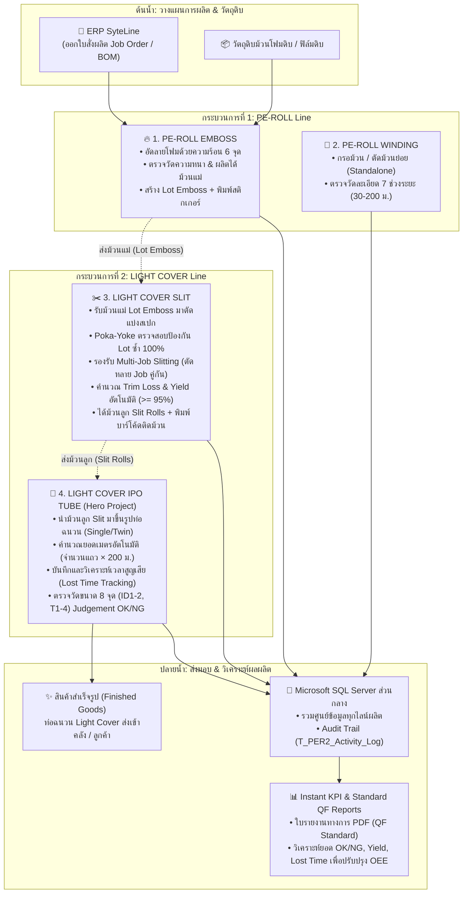

# แผนการนำเสนอประเมินผลการทดลองงาน (Probation Presentation Master Plan)
**ตำแหน่ง:** Full-Stack Developer | **บริษัท:** INOAC INDUSTRIES (THAILAND) CO., LTD.  
**ธีมหลัก:** *Digital Manufacturing Transformation & Web Operation: จากบันทึกกระดาษสู่ระบบดิจิทัลที่ขับเคลื่อนด้วย KPI*

---

## 4 วัตถุประสงค์หลักของระบบโรงงาน (Core Objectives)
ทุกโปรเจกต์ในไลน์ผลิตถูกออกแบบเพื่อตอบโจทย์ 4 เสาหลักนี้:
1. **ลดการเขียนมือของพนักงาน (Paperless):** เปลี่ยนจากการจดลงสมุด/กระดาษ มาใช้ Web App บนคอมพิวเตอร์หน้าเครื่อง สแกนบาร์โค้ดแทนการพิมพ์
2. **ลดความผิดพลาด (Error-Proofing):** คำนวณยอดเมตร, เวลาทำงาน, เวลาสูญเสีย และตรวจจับ Lot No. / สเปกอัตโนมัติ ไม่ต้องคำนวณในใจ
3. **จัดเก็บข้อมูลอย่างเป็นระบบ (Digital Data Capture & Traceability):** บันทึกเข้าสู่ฐานข้อมูล SQL Server ส่วนกลาง สามารถค้นหาประวัติย้อนหลังได้ในคลิกเดียว ตรวจสอบ Audit Log ได้ว่าใครแก้ไขเมื่อไหร่
4. **นำข้อมูลไปทำ KPI ได้ง่าย (Instant KPI & Analytics):** ระบบประมวลผลยอด OK, NG, Downtime / Lost Time และออกใบรายงาน PDF ตามฟอร์มมาตรฐานโรงงาน (QF) ได้ทันที ไม่ต้องรวบรวมข้อมูลด้วยมือตอนสิ้นเดือน

---

## 🗺️ แผนผังภาพรวมทั้ง 5 โปรเจกต์ (5 Projects Ecosystem)

```
┌────────────────────────────────────────────────────────────────────────────────────────┐
│                        เสาหลักที่ 1: SHOP FLOOR DIGITIZATION (โรงงาน)                  │
├──────────────────────────────────────────┬─────────────────────────────────────────────┤
│      สายที่ 1: PE-ROLL PRODUCTION LINE    │    สายที่ 2: LIGHT COVER PRODUCTION LINE    │
│  1. PE-ROLL EMBOSS (อัดลายฟิล์ม/โฟม)     │  3. LIGHT COVER SLIT (ตัดแบ่งสเปกฟิล์ม)     │
│  2. PE-ROLL WINDING (กรอม้วน/ตัดม้วน)    │  4. LIGHT COVER IPO TUBE (ขึ้นรูปท่อฉนวน)   │
└──────────────────────────────────────────┴─────────────────────────────────────────────┘
                                           │
┌──────────────────────────────────────────▼─────────────────────────────────────────────┐
│                       เสาหลักที่ 2: CORPORATE WEB OPERATIONS (องค์กร)                  │
├────────────────────────────────────────────────────────────────────────────────────────┤
│  5. WEBSITE REVAMP & MAINTENANCE (ดูแล/ปรับปรุงระบบเว็บสำเร็จรูปหลักของบริษัท)           │
└────────────────────────────────────────────────────────────────────────────────────────┘
```

---

## 🔄 Flow การทำงานโดยรวม (Overall Manufacturing & System Workflow)

เพื่อให้เห็นภาพการเชื่อมโยงของทั้ง 5 โปรเจกต์ในสายการผลิตจริง ระบบถูกออกแบบตามลำดับการไหลของวัตถุดิบและข้อมูล (Material & Data Flow) ดังนี้:

### 1. แผนภาพการไหลของกระบวนการผลิตจริง (Manufacturing Material Flow)



---

### 2. ลำดับการไหลของข้อมูลและระบบดิจิทัล (Digital System Architecture Flow)

```
[1. ข้อมูลเข้า (Input)]
  ├─ ยิงสแกนบาร์โค้ด Job No. ──► คิวรีข้อมูล Job, Part No., BOM จาก SyteLine ERP SQL Server อัตโนมัติ
  └─ กรณีงานด่วนยังไม่มี Job ──► เปิดโหมด Manual Mode (ระบบรันเลขจำลอง M-yyMMdd-xx ให้อัตโนมัติ)
           │
           ▼
[2. การประมวลผล & ป้องกันความผิดพลาดหน้าเครื่อง (Poka-Yoke & Smart Engine)]
  ├─ สแกน Lot Emboss ────────► ตรวจสอบ Real-Time กับฐานข้อมูล หากม้วนนี้เคยผ่าแล้ว จะขึ้น Toast เตือนและบล็อกทันที
  ├─ กรอกขนาดตัด / จำนวน ────► ระบบคำนวณหน้ากว้างรวม, Trim Loss, เศษเหลือ และ % Yield ทันที (แสดง Badge เขียวเมื่อ >= 95%)
  ├─ แถบ Visual Layout Bar ──► แสดงภาพหน้าตัดผ้าม้วน (เช่น Job 1: 621 มม. + Job 2: 469 มม. = 1,090 มม. เหลือ 20 มม.)
  └─ ระบบแป้นพิมพ์ Enter ────► กด Enter เลื่อนช่องอย่างปลอดภัย ไม่เผลอลั่นบันทึกงานก่อนเสร็จ
           │
           ▼
[3. การบันทึกและรักษาความถูกต้องข้อมูล (Commit & Data Integrity)]
  ├─ บันทึกผ่าน RESTful API (.NET Core) ──► ลงตาราง Head และ Detail ใน Microsoft SQL Server
  └─ ตรวจสอบและเก็บบันทึกประวัติ ────────► บันทึกผู้ใช้ เวลา และการกระทำลง T_PER2_Activity_Log
           │
           ▼
[4. ผลลัพธ์หน้างานและการจัดการ (Output & KPI Reports)]
  ├─ พิมพ์สติกเกอร์บาร์โค้ดติดม้วนลูกทันทีหน้าเครื่อง
  ├─ ออกเอกสารใบรายงานทางการ PDF ตามแบบฟอร์มมาตรฐาน QF ของโรงงาน
  └─ หน้าประวัติ Flat Jobs Table กรองแสดงเฉพาะ "งานของวันนี้" เป็นค่าเริ่มต้น ให้พนักงานเช็คยอดกะตนเองได้ทันที
```

---

### 3. ขั้นตอนการปฏิบัติงาน 5 ขั้นตอนของพนักงานหน้าเครื่อง (5-Step Operator Journey)

1. **เปิดหน้าจอประจำเครื่อง (Shift Initiation):** พนักงานเปิดเว็บแอปพลิเคชันหน้าเครื่อง ระบบจะแสดงตารางงานที่ผลิตใน **"วันนี้"** เป็นค่าเริ่มต้น พนักงานสามารถตรวจสอบยอดงานในกะของตนเองได้ทันทีโดยไม่ต้องกดค้นหา
2. **ยิงบาร์โค้ดใบงาน (Job Identification):** ใช้เครื่องยิงบาร์โค้ดสแกน Job Order จากเอกสารคำสั่งผลิต ระบบจะดึงรหัสชิ้นงาน (Part No.), คำอธิบายสินค้า และสเปกมาตรฐานจาก ERP มาให้อัตโนมัติ (หรือกดปุ่ม "ไม่มี Job" หากเป็นงานด่วน)
3. **ตรวจสอบม้วนแม่ (Poka-Yoke Verification):** สแกนหรือกรอก `Lot Emboss` ของม้วนโฟมที่ยกขึ้นเครื่อง ระบบจะตรวจเช็คกับฐานข้อมูลแบบเรียลไทม์ หากพบว่าม้วนนี้เคยถูกผ่าไปแล้ว ระบบจะแสดงแจ้งเตือนผ่าน Toast สีแดงและไม่อนุญาตให้บันทึก ป้องกันม้วนซ้ำ 100%
4. **คำนวณและปรับขนาดตัด (Smart Calculation & Cut Setup):** กรอกขนาดตัดและความกว้างจริง ระบบคำนวณเศษขอบ (Trim Loss) และ % Yield ทันที พร้อมแสดงแถบหน้าตัดผ้าม้วน (Visual Layout Bar) หากตัดคู่หลาย Job (Multi-Job) พนักงานสามารถกด Enter เพื่อเลื่อนไปยังช่องถัดไปได้อย่างรวดเร็ว
5. **บันทึก พิมพ์สติกเกอร์ และออกรายงาน (Commit & Print):** กดยืนยันบันทึกงาน ระบบจะจัดเก็บข้อมูลลง SQL Server พร้อมออกสติกเกอร์บาร์โค้ดสำหรับติดม้วนลูก และสามารถสั่งพิมพ์ใบรายงาน **QF Slit / IPO Tube Production Report (PDF)** เพื่อส่งต่อพร้อมชิ้นงานไปยังแผนกถัดไปได้อย่างสมบูรณ์

---

# รายละเอียดแต่ละโปรเจกต์: สไลด์ควรมีอะไรบ้าง และต้องพูดอะไรบ้าง

---

## 🔹 โปรเจกต์ที่ 1: PE-ROLL EMBOSS (กระบวนการอัดลายฟิล์ม PE-Roll)

### 1. บนสไลด์ควรมีอะไรบ้าง? (Visuals & Elements)
* **สไลด์ที่ 1 (ภาพรวม & Database):**
  * รูปม้วน PE-Roll จริงขนาดใหญ่
  * แผนผัง **ER Diagram** แสดง 3 ตารางหลัก:
    * `T_PER2_Emboss_Head` (ข้อมูลหลักใบงาน / Job Info)
    * `T_PER2_Emboss_Detail` (ข้อมูลม้วนแต่ละรอบ / Roll Details)
    * `T_PER2_Machine` (พารามิเตอร์เครื่องจักร / 6 Temperature Zones & Speed)
* **สไลด์ที่ 2 (หน้าจอใช้งานจริง):**
  * แคปหน้าจอ **ฟอร์มบันทึกหน้างาน (Data Entry Form):**
    * กล่องที่ 1: สแกน Job No. $\rightarrow$ Auto-fill BOM & Part No.
    * กล่องที่ 2: ตารางบันทึกรายม้วน (Lot, ความหนา, กว้าง, ยาว, งานเสีย, ผู้ผลิต, Judgement OK/NG)
    * กล่องที่ 3: พารามิเตอร์เครื่อง (ความเร็ว, อุณหภูมิน้ำหล่อเย็น, อุณหภูมิความร้อน 6 จุด)
  * รูปใบรายงานทางการ **PDF รายงานการผลิต EMBOSS**

### 2. บทพูดที่ควรพูด (Speaking Script)
> *"สำหรับโปรเจกต์แรกคือ **PE-ROLL EMBOSS** ซึ่งเป็นกระบวนการอัดลายแผ่นโฟมและฟิล์ม PE ค่ะ*  
> 
> * **ปัญหาเดิม:** พนักงานต้องคอยจดอุณหภูมิเครื่องจักรทั้ง 6 จุดและค่าความหนาลงกระดาษทุกรอบ ทำให้ลายมืออ่านยาก เสี่ยงต่อการบันทึกสลับ Lot และสิ้นวันต้องนำกระดาษมาพิมพ์ลง Excel อีกรอบ*  
> * **สิ่งที่ดิฉันพัฒนา:** 
>   1. ดิฉันได้ออกแบบฐานข้อมูลแยกตาราง Head, Detail และ Machine Parameters อย่างเป็นระบบ รองรับการบันทึก 1 Job หลายม้วน
>   2. หน้าเว็บรองรับการยิงบาร์โค้ด Job เพื่อดึง BOM และสเปกมาตรฐานมาให้อัตโนมัติ โดยที่พนักงานไม่ต้องจำ
>   3. ควบคุมคุณภาพด้วยการให้ระบบตัดสินผลการตรวจ (Judgement) เป็น OK หรือ NG อัตโนมัติทันทีที่กรอกค่า
>   4. เชื่อมโยงสู่ออกใบรายงานผลผลิต PDF ตามแบบฟอร์มมาตรฐานของบริษัททันทีที่เสร็จงาน*  
> * **ผลลัพธ์:** ลดเวลาการบันทึกหน้างาน และสามารถติดตามพารามิเตอร์เครื่องจักรย้อนหลังได้ 100% ค่ะ"*

---

## 🔹 โปรเจกต์ที่ 2: PE-ROLL WINDING (กระบวนการกรอม้วนและตัดม้วน)

### 1. บนสไลด์ควรมีอะไรบ้าง? (Visuals & Elements)
* **สไลด์ 1 (ฟอร์มบันทึกข้อมูล & สถาปัตยกรรมฐานข้อมูล):**
  * หน้าบันทึกแยกอิสระจากกระบวนการ Emboss (Independent Operation)
  * ฟอร์มตรวจวัดมิติความกว้าง (Width) และความหนา (Thickness) ละเอียด 7 ช่วงระยะ (30, 60, 90, 120, 150, 180, 200 ม.)
  * สถาปัตยกรรมตารางข้อมูล 4 ตาราง (Head, Detail, Wide, Thickness)
* **สไลด์ 2 (Before vs. After & ใบรายงานดิจิทัล PDF + สติกเกอร์ QR Code):**
  * ฝั่งซ้าย (Before): ใบบันทึกรายงานการม้วนโฟมกระดาษเดิม เขียนด้วยลายมือ มีความเสี่ยงในการคำนวณและสูญหาย
  * สติกเกอร์ติดม้วนประจำ Job พร้อม QR Code: ระบุ Job `S106501382`, Part No `P113014065`, Description `TC-4(BK)5X1000X150M`, Lot `2026-10-11`, Qty `60 M.`, Roll `7/7`
  * ฝั่งขวา (After): ใบรายงานดิจิทัล PDF "Winding Report / รายงานการม้วนโฟม" ครบถ้วนตามมาตรฐาน บันทึกผลตรวจวัด 7 ม้วน สรุปยอดผลิตรวม 960 เมตร, น้ำหนักรวม 207.41 กก., ค่า MIN: 15.15, MAX: 32.06 พร้อมช่องลงนามอนุมัติ 3 ระดับ (Operator, Foreman, Manager)

### 2. บทพูดที่ควรพูด (Speaking Script)
> *"โปรเจกต์ที่ 2 คือ **PE-ROLL WINDING** ซึ่งเป็นระบบสำหรับกระบวนการกรอม้วนและตัดแบ่งม้วน ที่**ทำงานแยกส่วนอย่างเป็นอิสระจาก Emboss** ค่ะ*  
> 
> * **โจทย์สำคัญ:** ในการทำงานจริง เครื่อง Winding มีกระบวนการและสเปกการผลิตเฉพาะตัว พนักงานต้องคำนวณและบันทึกข้อมูลม้วน น้ำหนัก และความยาวแยกต่างหาก หากบันทึกด้วยกระดาษจะเกิดความล่าช้าและสูญหายง่าย*  
> * **สิ่งที่ดิฉันพัฒนา:** 
>   1. ออกแบบระบบบันทึกหน้างานเฉพาะของไลน์ Winding รองรับการกรอกข้อมูลและสแกนหน้าเครื่องได้อย่างรวดเร็ว
>   2. มีระบบคำนวณและตรวจสอบความยาวและน้ำหนักม้วนจริงเทียบกับเกณฑ์มาตรฐานอัตโนมัติ
>   3. บันทึกงานเสียจากการตัดหัว-ท้ายม้วนและรอยต่อ เพื่อให้ฝ่ายผลิตเห็นเปอร์เซ็นต์ Yield ของการกรอม้วนแบบเรียลไทม์*  
> * **ผลลัพธ์:** พนักงานหน้าเครื่อง Winding ทำงานได้คล่องตัว บันทึกข้อมูลได้แม่นยำ ไม่ต้องพึ่งพากระดาษ และมีข้อมูลผลผลิตของไลน์ Winding ตรวจสอบย้อนกลับได้ทันทีค่ะ"*

---

## 🔹 โปรเจกต์ที่ 3: LIGHT COVER SLIT (กระบวนการตัดแบ่งสเปกฟิล์ม)

### 1. บนสไลด์ควรมีอะไรบ้าง? (Visuals & Elements)
* **หน้าจอตัดสลิต (Slit Web Application):**
  * การเชื่อมต่อค้นหาข้อมูล Job จากระบบ ERP (SyteLine SQL Server) แบบเรียลไทม์
  * **ระบบ Error-Proofing (Poka-Yoke):** ตรวจจับป้องกันการใช้ Lot Emboss ซ้ำแบบเรียลไทม์ (ม้วนแม่ 1 ม้วนผ่าได้ครั้งเดียว) แจ้งเตือนกระชับด้วย Toast Notification ไม่รกสายตา และบล็อกในระดับ API (409 Conflict)
  * **Multi-Job Slitting:** รองรับการผ่า 1 ม้วนแม่แบ่งเป็นหลาย Job ย่อยพร้อมกัน (Job 1 + Job 2) พร้อม **แถบแสดงภาพหน้าตัดผ้าม้วน (Visual Layout Bar)** สรุปยอดความกว้างและเศษขอบสด
  * **Manual Mode (โหมดงานไม่มี Job):** รันหมายเลข Job จำลองอัตโนมัติ `M-yyMMdd-xx` สำหรับงานด่วนก่อนใบงานระบบหลักออก
  * **Ergonomic Shop-Floor UX:** ตารางประวัติงาน (Flat Jobs Table) แสดงเฉพาะงานของ "วันนี้" เป็นค่าเริ่มต้น ให้เช็คยอดกะตนเองได้ทันที พร้อมระบบแป้นพิมพ์กด Enter ข้ามช่องอย่างราบรื่น ไม่ลั่นบันทึก
  * **Smart Yield Engine:** คำนวณเศษขอบ (Trim Loss), เศษหน้ากว้างเหลือ (Remnant), ปริมาณการใช้จริง และคำนวณ % Yield สดพร้อม Badge สีเขียวแสดงผลเมื่อผ่านเกณฑ์ >= 95%
  * ฟังก์ชันการพิมพ์ใบรายงาน **QF Slit Production Report PDF** และพิมพ์สติกเกอร์บาร์โค้ดติดม้วนย่อย

### 2. บทพูดที่ควรพูด (Speaking Script)
> *"ข้ามมาที่สายการผลิตที่สอง คือสาย **LIGHT COVER** เริ่มจากกระบวนการ **LIGHT COVER SLIT** ค่ะ*  
> 
> * **โจทย์หน้างาน:** ม้วนโฟมแม่ 1 ม้วนใหญ่ (Lot Emboss) จะต้องถูกนำมาตัดแบ่งออกเป็นแถบย่อยตามขนาด ซึ่งในอดีตคำนวณเศษขอบยาก และเสี่ยงต่อการนำม้วนแม่ที่เคยผ่าไปแล้วมาบันทึกซ้ำซ้อนในระบบสต็อก*  
> * **สิ่งที่ดิฉันพัฒนา:** 
>   1. **ERP Integration:** เชื่อมต่อกับ SyteLine ดึงข้อมูล Job Order, รหัส Part No. และสเปกม้วนโฟมมาแสดงอัตโนมัติ
>   2. **Error-Proofing (ป้องกัน Lot ซ้ำ 100%):** สร้างระบบตรวจจับแบบเรียลไทม์ทั้งหน้าเว็บและฐานข้อมูล หากสแกนหรือกรอก Lot Emboss ที่เคยผลิตไปแล้ว ระบบจะแจ้งเตือนผ่าน Toast ทันทีและบล็อกไม่ให้บันทึกซ้ำโดยเด็ดขาด
>   3. **Multi-Job Slitting:** รองรับการผ่า 1 ม้วนแม่แบ่งออกเป็นหลาย Job พร้อมกัน เช่น ผ่าตัดคู่ Job 1 และ Job 2 พร้อมแถบภาพหน้าตัดผ้าม้วนคำนวณยอดหน้ากว้างสุทธิ
>   4. **Manual Mode (โหมดไม่มี Job):** ในกรณีที่ใบงานหลักยังไม่ออก พนักงานสามารถเลือกโหมดกรอกเอง โดยระบบจะรันเลข Job ให้อัตโนมัติ (`M-yyMMdd-xx`) เพื่อให้ไลน์ผลิตทำงานต่อเนื่องได้ทันที
>   5. **Ergonomic Operator Workflow:** ออกแบบตารางแสดงรายการผลิตเฉพาะของ 'วันนี้' เพื่อให้พนักงานตรวจนับยอดในกะได้ทันที และควบคุมการกดปุ่ม Enter ให้เลื่อนไปยังช่องถัดไปอย่างราบรื่น ไม่เผลอกดข้ามไปบันทึกงาน
>   6. **Smart Yield Engine:** คำนวณเศษขอบ (Trim Loss), เศษหน้ากว้างเหลือ (Remnant) และ % Yield ทันที พร้อมแสดงสถานะสีเขียวเมื่อผ่านเกณฑ์เป้าหมาย 95% ขึ้นไป
>   7. **Standard QF Report & Sticker Printing:** ออกใบรายงาน PDF มาตรฐาน QF และพิมพ์สติกเกอร์บาร์โค้ดติดม้วนลูกได้ทันทีหน้าเครื่อง*  
> * **ผลลัพธ์:** ป้องกันการบันทึกม้วนซ้ำ 100%, คุมต้นทุนและเศษสูญเสีย (Yield) ได้ตามเกณฑ์ และส่งต่องานไปยังแผนกถัดไป (IPO Tube) ได้อย่างแม่นยำค่ะ"*

---

## 🔹 โปรเจกต์ที่ 4: LIGHT COVER IPO TUBE (กระบวนการขึ้นรูปท่อฉนวน) ⭐ *Hero Project*

### 1. บนสไลด์ควรมีอะไรบ้าง? (Visuals & Elements)
* **สไลด์ 1 (ฟอร์มบันทึก 3-Column Ergonomic UI):**
  * โชว์ Layout 3 คอลัมน์ที่ออกแบบตามขั้นตอนทำงาน (Ergonomic Web UI): ข้อมูล Job & วัตถุดิบ | ตรวจสอบขนาด 2 ท่อ | เครื่องจักร & ผลผลิต
  * Callout ชี้ฟังก์ชัน **"Smart Calculate: ใส่จำนวนแถว $\rightarrow$ คำนวณยอดเมตรอัตโนมัติ ($\times 200$ ม.)"**
  * Callout ชี้ฟังก์ชัน **"Dual Tube Support: รองรับทั้งท่อเดี่ยว และท่อคู่ (Twin Tube)"**
* **สไลด์ 2 (Lost Time Tracking & QA Judgement):**
  * กล่องระบุเวลาเสีย: เช่น `08:00 - 08:30 ประชุม` $\rightarrow$ ระบบตัดเวลาทำงานสุทธิ (Net Time) ให้อัตโนมัติ
  * ตารางตรวจวัดขนาด: ค่า ID1-2, T1-4, ค่าเฉลี่ย AVG และการตัดเกรด OK/NG
* **สไลด์ 3 (ใบรายงานทางการ PDF Report):**
  * ใบรายงาน PDF ขนาด A4 แนวนอนที่มีฟอนต์ Sarabun คมชัด
  * ไฮไลต์ **ตารางสรุป Lost Time ราย Job ด้านล่าง** สำหรับการพิมพ์รวมทั้งเดือน/ช่วงวันที่

### 2. บทพูดที่ควรพูด (Speaking Script)
> *"มาถึงโปรเจกต์ที่เป็นตัวเด่นทางเทคนิคที่สุด คือ **LIGHT COVER IPO TUBE** ซึ่งเป็นกระบวนการขึ้นรูปท่อฉนวนในแผนก Pipe Set ค่ะ*  
> 
> * **ปัญหาเดิม:** เป็นกระบวนการที่ซับซ้อนที่สุด พนักงานต้องจดมิติการตรวจสอบทั้งท่อ 1 และท่อ 2 (กรณีท่อคู่), ต้องคอยคูณยอดเมตรจากจำนวนแถวด้วยตัวเอง, และเมื่อมีเวลาเครื่องหยุด พนักงานมักไม่ได้จดช่วงเวลา ทำให้ฝ่ายบริหารไม่รู้ว่าเวลาในกะหายไปไหน*  
> * **ฟังก์ชันเด่นที่ดิฉันพัฒนาขึ้นเพื่อแก้ปัญหา:**
>   1. **Smart Auto-Calculate:** ให้พนักงานกรอกแค่ 'จำนวนแถว' เช่น ใส่เลข 8 ระบบจะคำนวณเป็น 1,600 เมตรให้อัตโนมัติ ลดการกดเครื่องคิดเลขผิดพลาด
>   2. **Lost Time Tracking:** เพิ่มช่องระบุช่วงเวลาหยุดผลิตจริง เช่น `08:00 - 08:30 ประชุม` ระบบจะหักลบเวลาออกจากเวลารวมเป็นเวลาทำงานจริงให้ทันที พร้อมจัดหมวดหมู่ส่งเข้าตารางสรุป KPI
>   3. **Dual Tube Inspection:** ออกแบบระบบให้รองรับทั้งท่อเดี่ยวและท่อคู่ ตรวจสอบค่าความหนาและเส้นผ่านศูนย์กลาง 8 จุด พร้อมสรุปผล OK/NG ทันที
>   4. **Advanced PDF Engine:** พัฒนาระบบสร้างไฟล์ PDF มาตรฐาน QF-PF ภาษาไทย ที่รองรับการพิมพ์ทั้งแบบราย Job และแบบสรุปประจำเดือน พร้อมแจกแจงสาเหตุเวลาเสียรายรอบไว้อย่างสมบูรณ์*  
> * **ผลลัพธ์:** พนักงานทำงานเร็วขึ้นกว่า 50%, ข้อมูลมิติการตรวจแม่นยำ 100%, และผู้จัดการสามารถนำข้อมูลเวลาเสียไปปรับปรุง OEE ได้ทันทีค่ะ"*

---

## 🔹 โปรเจกต์ที่ 5: WEBSITE REVAMP & MAINTENANCE (เว็บไซต์องค์กร)

### 1. บนสไลด์ควรมีอะไรบ้าง? (Visuals & Elements)
* **หน้าตาเว็บไซต์หลักของบริษัท (INOAC INDUSTRIES THAILAND):**
  * ภาพหน้าแรก (Homepage), หมวดสินค้า (Products), หน้าบริการ (Service), หน้าติดต่อเรา (Contact Us)
  * แสดงจุดที่มีการปรับปรุง เช่น:
    * ปรับปรุงหน้าตา UI ให้ทันสมัย (Modern UI) สอดคล้องกับภาพลักษณ์องค์กรระดับสากล
    * การปรับปรุงโครงสร้างหมวดหมู่ผลิตภัณฑ์ให้ค้นหาง่ายขึ้น
    * การรองรับ Responsive บนสมาร์ตโฟนและแท็บเล็ต
    * การดูแลช่องทางรับข้อมูลลูกค้า (Inquiry / Contact Form)
* **การดูแลระบบหลังบ้าน (CMS / Webmaster Duties):**
  * การจัดการ Asset รูปภาพ, การตรวจสอบ Broken Link, และการสำรองข้อมูลเว็บไซต์

### 2. บทพูดที่ควรพูด (Speaking Script)
> *"นอกจากโปรเจกต์ระบบภายในโรงงานแล้ว อีกหนึ่งหน้าที่สำคัญที่ดิฉันได้รับมอบหมาย คือโปรเจกต์ **WEBSITE REVAMP & MAINTENANCE** ค่ะ*  
> 
> * **บทบาทหน้าที่:** บริษัทได้จัดซื้อระบบเว็บไซต์สำเร็จรูปมาใช้งาน โดยดิฉันทำหน้าที่เป็น **Web Developer & Webmaster** ในการดูแล, ปรับปรุง และบริหารจัดการทั้งหน้าบ้านและหลังบ้าน*  
> * **สิ่งที่ดิฉันได้ดำเนินการ:**
>   1. **UI/UX & Content Revamp:** ปรับปรุงโครงสร้างหน้าเว็บ หน้าแคตตาล็อกสินค้า และเนื้อหาข้อมูลของบริษัทให้ทันสมัย ถูกต้อง และดึงดูดลูกค้ามากขึ้น
>   2. **Responsive & Performance:** ปรับแต่งการแสดงผลรูปภาพและโครงสร้างให้โหลดได้รวดเร็ว และแสดงผลได้สมบูรณ์แบบทั้งบนคอมพิวเตอร์และมือถือ
>   3. **Inquiry & Lead Management:** ตรวจสอบและดูแลระบบฟอร์มติดต่อลูกค้า (Contact Us) ให้ส่งข้อมูลไปยังผู้เกี่ยวข้องได้อย่างถูกต้อง ไม่ตกหล่น
>   4. **System Maintenance & Security:** คอยตรวจสอบความปลอดภัย, อัปเดตแพตช์ และดูแลระบบไม่ให้เกิด Downtime*  
> * **ผลลัพธ์:** ทำให้เว็บไซต์ของบริษัทพร้อมเป็นช่องทางประชาสัมพันธ์และสร้างความน่าเชื่อถือให้กับลูกค้ารายใหม่ตลอด 24 ชั่วโมงค่ะ"*

---

## 📊 สไลด์สรุปผลงานภาพรวม (Total Impact & KPI Achievement)

### สิ่งที่ควรมีบนสไลด์สรุป
ตารางเปรียบเทียบ **Before vs After** ตาม 4 วัตถุประสงค์หลัก:

| วัตถุประสงค์ | ก่อนมีระบบ (Before) | หลังมีระบบ (After) | ผลลัพธ์ที่ได้ |
| :--- | :--- | :--- | :---: |
| **1. ลดการเขียนมือ** | จดลงกระดาษ ลายมืออ่านยาก กระดาษเปื้อน/หาย | บันทึกผ่าน Web App 100% สแกนบาร์โค้ดแทนการพิมพ์ | **Paperless 100%** |
| **2. ลดความผิดพลาด (Error-Proofing)** | คำนวณยอดเมตร/เวลาผิด, สลับ Lot, นำม้วนแม่ (Lot Emboss) มาผ่าซ้ำ | ระบบคำนวณอัตโนมัติ ตรวจจับห้ามซ้ำ Lot แบบ Real-Time ป้องกันการบันทึกซ้ำ 100% | **Zero Duplicate & Error = 0%** |
| **3. เก็บข้อมูลเป็นระบบ** | ข้อมูลกระจายตามแฟ้ม ค้นหาประวัติใช้เวลาครึ่งวัน | รวมศูนย์ใน SQL Server ค้นหาได้ใน 1 วินาที มี Audit Log | **Traceability 100%** |
| **4. นำไปทำ KPI ง่าย** | สิ้นเดือนต้องมานั่งรวมตัวเลขกระดาษทีละแผ่น | ดึงรายงานสรุปยอดผลิต / งานเสีย / Lost Time ได้ทันที | **Real-time Report** |

### บทพูดปิดท้าย (Closing Statement)
> *"สรุปภาพรวมตลอดระยะเวลาทดลองงาน ทั้ง 5 โปรเจกต์นี้ไม่เพียงแต่ช่วยให้กระบวนการผลิตของโรงงานเราก้าวเข้าสู่ระบบดิจิทัลอย่างเป็นรูปธรรมเท่านั้น แต่ยังช่วยลดภาระงานของพนักงานหน้าเครื่อง เพิ่มความถูกต้องของข้อมูล และทำให้ฝ่ายบริหารมีข้อมูลคุณภาพสูงในการนำไปวิเคราะห์ KPI ต่อไปได้ทันทีค่ะ*  
> 
> *ในอนาคต ดิฉันมีความพร้อมที่จะนำโครงสร้างระบบนี้ไปต่อยอดทำ Real-time OEE Dashboard และขยายผลไปยังสายการผลิตอื่นๆ ของบริษัทต่อไปค่ะ ขอขอบพระคุณคณะกรรมการทุกท่านค่ะ"*

---

# 🌐 บทนำเสนอภาษาอังกฤษแบบมืออาชีพ (English Presentation Script & Guide)
(พร้อมคำอ่านโฟเนติกภาษาไทย คำแปล และเทคนิคภาษากาย/การนำเสนอ)

---

### 📌 Slide 1: Cover Slide (หน้าปกการนำเสนอ)
Visual: โลโก้ INOAC, หัวข้อ "Production Modernization System", ชื่อผู้เสนอ Chutima Chawkrathok

English Script:
Good morning, esteemed committee and colleagues. Welcome to my probation evaluation presentation. Today, I am proud to present the Production Modernization System project for 2026. My name is Chutima Chawkrathok.

คำอ่านไทย:
กู้ด มอร์นิ่ง / เอสทีมดฺ คอมมิตที แอนด์ คอลลีกส์ / เวลคัม ทู มาย โพรเบเชิน อิแวลูเอเชิน พรีเซนเทเชิน / ทูเดย์ / ไอ แอม พราวด์ ทู พรีเซนต์ เดอะ โพรดัคชัน มอเดอร์ไนเซเชิน ซิสเต็ม โพรเจกต์ ฟอร์ ทเวนตี ทเวนตี-ซิกส์ / มาย เนม อิส ชุติมา เชาว์กระโทก

คำแปล:
สวัสดีตอนเช้าคณะกรรมการผู้ทรงเกียรติและเพื่อนร่วมงานทุกท่านค่ะ ยินดีต้อนรับสู่การนำเสนอประเมินผลการทดลองงานของดิฉัน วันนี้ดิฉันมีความภาคภูมิใจเป็นอย่างยิ่งที่จะนำเสนอโครงการพัฒนาระบบการผลิตสู่ดิจิทัล ประจำปี 2026 ดิฉันชื่อ ชุติมา เชาว์กระโทก ค่ะ

เทคนิคการพูด & ภาษากาย:
- ยืนตัวตรง ยิ้มแย้ม สบตาคณะกรรมการทุกคน (Eye contact)
- เว้นจังหวะสั้นๆ หลังกล่าวคำว่า Good morning ก่อนเริ่มเข้าสู่ชื่อหัวข้อ
- ผายมือเล็กน้อยไปยังหน้าจอเมื่อพูดถึงชื่อโครงการ

---

### 📌 Slide 2: Personal Information (ประวัติส่วนตัว)
Visual: ภาพโปรไฟล์, การศึกษา มทร.อีสาน วิศวกรรมคอมพิวเตอร์, ตำแหน่ง IT Programmer, วันเริ่มงาน

English Script:
Allow me to briefly introduce myself. I graduated with a Bachelor's Degree in Computer Engineering from Rajamangala University of Technology Isan. I joined INOAC Industries Thailand on July 21st, 2026, as an IT Programmer under the Information Technology department.

คำอ่านไทย:
อะลาว มี ทู บรีฟลี่ อินโทรดิวส์ มายเซลฟ์ / ไอ แกรจูเอทิด วิธ อะ แบชเชอเลอร์ส ดีกรี อิน คอมพิวเตอร์ เอนจิเนียริ่ง / ฟรอม ราชมังคลา ยูนิเวอร์ซิตี ออฟ เทคโนโลยี อีสาน / ไอ จอยน์ดฺ ไอโนแอก อินดัสทรีส์ ไทยแลนด์ ออน จูลาย ทเวนตี-เฟิร์สท์, ทเวนตี ทเวนตี-ซิกส์ / แอส แอน ไอที โปรแกรมเมอร์ อันเดอร์ ดิ อินฟอร์เมชัน เทคโนโลยี ดีพาร์ตเมนต์

คำแปล:
ขออนุญาตแนะนำตัวสั้นๆ ค่ะ ดิฉันสำเร็จการศึกษาระดับปริญญาตรี สาขาวิศวกรรมคอมพิวเตอร์ จากมหาวิทยาลัยเทคโนโลยีราชมงคลอีสาน และได้เริ่มงานกับ บริษัท ไอโนแอก อินดัสทรีส์ (ประเทศไทย) เมื่อวันที่ 21 กรกฎาคม 2026 ในตำแหน่ง IT Programmer สังกัดแผนกเทคโนโลยีสารสนเทศค่ะ

เทคนิคการพูด & ภาษากาย:
- น้ำเสียงสดใส มั่นใจ และสุภาพ
- ผายมือไปที่รูปถ่ายของตนเองบนสไลด์

---

### 📌 Slide 3: Dev Portfolio Tree (แผนผังโครงสร้างโปรเจกต์)
Visual: แผนผังต้นไม้แบ่งเป็น Production Modernization System (PE-ROLL: EMBOSS [Completed], WINDING [In Progress]) และ (LIGHT COVER: SLIT [In Progress], IPO TUBE [Hero Project / In Progress]) กับ CORPORATE DIGITAL (WEBSITE REVAMP [In Progress])

English Script:
Here is the overall scope of my responsibilities, divided into two main pillars:
First, the Production Modernization System, which focuses on shop-floor digitalization across two production lines:
Under PE-ROLL, we have the EMBOSS process, which is now successfully completed, and the WINDING process, which operates independently and is currently in progress.
Under LIGHT COVER, both the SLIT and IPO TUBE processes are actively under development.
Second, in Corporate Digital, I am also responsible for maintaining and revamping our corporate website.

คำอ่านไทย:
เฮียร์ อิส ดิ โอเวอร์ออล สโคป ออฟ มาย ริสปอนซิิลิทีส์ / ดิไวดิด อินทู ทู เมน พิลลาร์ส:
เฟิร์สท์ / เดอะ โพรดัคชัน มอเดอร์ไนเซเชิน ซิสเต็ม / วิช โฟกัสเซส ออน ช็อป-ฟลอร์ ดิจิทัลไลเซเชิน อะครอส ทู โพรดัคชัน ไลนส์:
อันเดอร์ พีอี-โรล / วี แฮฟ ดิ เอ็มบอสส์ โพรเซส / วิช อิส นาว ซัคเซสฟูลลี่ คอมพลีทิด / แอนด์ เดอะ ไวน์ดิ่ง โพรเซส / วิช ออพเพอเรทส์ อินดีเพนเดนท์ลี่ แอนด์ อิส เคอร์เรนท์ลี่ อิน โพรเกรส /
อันเดอร์ ไลท์ คัฟเวอร์ / โบธ เดอะ สลิต แอนด์ ไอพีโอ ทิวบ์ โพรเซสเซส อาร์ แอคทีฟลี่ อันเดอร์ ดิเวลลอปเมนต์ /
เซคคันด์ / อิน คอร์ปอเรท ดิจิทัล / ไอ แอม ออลโซ ริสปอนซิเบิล ฟอร์ เมนเทนนิ่ง แอนด์ รีแวมปิ้ง เอาเออะ คอร์ปอเรท เว็บไซต์

คำแปล:
นี่คือภาพรวมขอบเขตงานทั้งหมดของดิฉัน ซึ่งแบ่งออกเป็น 2 เสาหลักค่ะ:
เสาหลักแรก คือ ระบบปรับปรุงสายการผลิตสู่ดิจิทัล โดยมุ่งเน้นการเปลี่ยนการบันทึกหน้างานให้เป็นดิจิทัลใน 2 สายการผลิต:
ในสาย PE-ROLL ประกอบด้วยกระบวนการ EMBOSS ซึ่งเสร็จสมบูรณ์เรียบร้อยแล้ว และกระบวนการ WINDING ซึ่งทำงานแยกเป็นอิสระและกำลังอยู่ระหว่างการพัฒนาค่ะ
ในสาย LIGHT COVER ทั้งกระบวนการ SLIT และ IPO TUBE กำลังอยู่ระหว่างการพัฒนาอย่างต่อเนื่องค่ะ
และเสาหลักที่สอง คือ งานดิจิทัลระดับองค์กร ซึ่งดิฉันรับผิดชอบดูแลและปรับปรุงเว็บไซต์หลักของบริษัทค่ะ

เทคนิคการพูด & ภาษากาย:
- จุดสำคัญมาก: เน้นเสียงหนักแน่นที่คำว่า operates independently เพื่อย้ำให้คณะกรรมการทราบว่า Winding ทำงานแยกส่วนกับ Emboss ไม่ได้ขึ้นต่อกัน
- ใช้มือชี้ตามกิ่งของแผนผัง ซ้ายไปขวา (PE-Roll -> Light Cover -> Corporate Digital)

---

### 📌 Slide 4: Action Plan & Project Timeline (แผนการดำเนินงาน)
Visual: ตาราง Gantt Chart แสดงช่วงเวลา July - October 2026 ครอบคลุม 6 ขั้นตอน

English Script:
Moving to our Action Plan, this timeline covers my development lifecycle from July to October 2026.
It is structured into six key phases: starting with Requirements Analysis and System Design in the first two months, followed by Implementation and Comprehensive Testing.
As shown by the progress bars, we have successfully deployed core modules and are now entering the final testing and continuous maintenance phase.

คำอ่านไทย:
มูฟวิ่ง ทู เอาเออะ แอคชัน แพลน / ดิส ไทม์ไลน์ คัฟเวิร์ส มาย ดิเวลลอปเมนต์ ไลฟ์ไซเคิล ฟรอม จูลาย ทู ออคโทเบอร์ ทเวนตี ทเวนตี-ซิกส์ /
อิท อิส สตรัคเชอร์ดฺ อินทู ซิกส์ คีย์ เฟสเซส: สตาร์ทติ้ง วิธ รีไควร์เมนท์ส อะแนลลิซิส แอนด์ ซิสเต็ม ดีไซน์ อิน เดอะ เฟิร์สท์ ทู มันธ์ส / ฟอลโลวด์ บาย อิมพลีเมนเทเชิน แอนด์ คอมพรีเฮนซีฟ เทสติ้ง /
แอส โชวน์ บาย เดอะ โพรเกรส บาร์ส / วี แฮฟ ซัคเซสฟูลลี่ ดิพลอยด์ คอร์ มอดูลส์ แอนด์ อาร์ นาว เอนเทอร์ริ่ง เดอะ ไฟนอล เทสติ้ง แอนด์ คอนทินิวอัส เมนเทนแนนซ์ เฟส

คำแปล:
ถัดมาที่ แผนการดำเนินงาน ค่ะ แผนภาพนี้ครอบคลุมวงจรการพัฒนาตลอดช่วงเดือนกรกฎาคมถึงตุลาคม 2026
แบ่งออกเป็น 6 ขั้นตอนหลัก: เริ่มตั้งแต่การเก็บความต้องการและออกแบบระบบในช่วงสองเดือนแรก ตามด้วยการเขียนโค้ดและทดสอบระบบอย่างครอบคลุม
ดังที่แสดงในแถบความคืบหน้า เราได้ติดตั้งระบบหลักขึ้นใช้งานแล้ว และขณะนี้กำลังอยู่ในช่วงทดสอบขั้นสุดท้ายและบำรุงรักษาอย่างต่อเนื่องค่ะ

เทคนิคการพูด & ภาษากาย:
- กวาดสายตามองไทม์ไลน์ พร้อมผายมือจากซ้าย (July) ไปยังขวา (October) แสดงความคืบหน้าของโปรเจกต์

---

### 📌 Slide 5: Pain Points & Project Goals (ความท้าทายและทางแก้ปัญหา)
Visual: กล่องเปรียบเทียบ Before (The Challenges - สีฟ้า) vs After (The Solutions - สีเขียว)

English Script:
Before diving into the system demo, let us look at the Pain Points and Project Goals.
Previously, our shop floor faced four major challenges:
1. Manual Data Entry: writing on paper was slow and inefficient.
2. Human Errors: calculation mistakes in rows, meters, and working time.
3. Data Loss: paper logs were difficult to track and easy to lose.
4. Time-Consuming Reports: creating end-of-day summaries took hours.

To solve this, I engineered four modern solutions:
1. Barcode Scanning with Ergonomic Web UI for rapid entry.
2. An Auto-Calculation Engine to achieve 100% computational accuracy.
3. Digital Traceability with a centralized SQL database for 1-click historical search.
4. And Instant KPI & PDF Reports, generating standard factory QF sheets in real time.

คำอ่านไทย:
บีฟอร์ ไดวิ่ง อินทู เดอะ ซิสเต็ม เดโม / เล็ท อัส ลุค แอท เดอะ เพน พอยต์ส แอนด์ โพรเจกต์ โกลส์ /
พรีเวียสลี่ / เอาเออะ ช็อป ฟลอร์ เฟสดฺ โฟร์ เมเจอร์ แชลเลนเจส:
วัน: แมนนวล ดาต้า เอนทรี / ไรท์ติ้ง ออน เพเพอร์ เวิส สโลว์ แอนด์ อินเอฟฟิเชียนท์ /
ทู: ฮิวแมน เออร์เรอร์ส / แคสคูเลเชิน มิสเทคส์ อิน โรวส์ / มิเตอร์ส / แอนด์ เวิร์คกิ้ง ไทม์ /
ทรี: ดาต้า ลอสส์ / เพเพอร์ ล็อกส์ เวิร์ ดิฟฟิคัลท์ ทู แทร็ก แอนด์ อีซี่ ทู ลูส /
โฟร์: ไทม์-คอนซูมมิ่ง รีพอร์ตส / ครีเอทติ้ง เอนด์-ออฟ-เดย์ ซัมมารีส์ ทุค เอาเอิร์ส /

ทู ซอลฟ์ ดิส / ไอ เอนจิเนียร์ดฺ โฟร์ มอเดิร์น โซลูชันส์:
วัน: บาร์โค้ด สแกนนิ่ง วิธ เออร์โกโนมิค เว็บ ยูไอ ฟอร์ แรพพิด เอนทรี /
ทู: แอน ออโต้-แคลคูเลเชิน เอนจิน ทู อะชีฟ วัน ฮันเดร็ด เพอร์เซนต์ คอมพิวเทชันนอล แอคคิวระซี /
ทรี: ดิจิทัล เทรซาบิลิตี วิธ อะ เซ็นทรัลไลซ์ดฺ เอสคิวแอล ดาต้าเบส ฟอร์ วัน-คลิก ฮิสทอริเคิล เซิร์ช /
โฟร์: แอนด์ อินสแตนท์ เคพีไอ แอนด์ พีดีเอฟ รีพอร์ตส / เจนเนอเรทติ้ง สแตนดาร์ด แฟคทอรี คิวเอฟ ชีทส์ อิน เรียล ไทม์

คำแปล:
ก่อนจะเข้าสู่การสาธิตระบบ ขอพาคณะกรรมการทุกท่านมาดูที่ ปัญหาเดิมและเป้าหมายของโครงการ ค่ะ
ในอดีต หน้างานโรงงานของเราพบกับ 4 ความท้าทายหลัก:
1. การบันทึกด้วยมือ: การเขียนลงกระดาษทั้งช้าและไม่มีประสิทธิภาพ
2. ความผิดพลาดจากพนักงาน: คำนวณจำนวนแถว ยอดเมตร และเวลาทำงานคลาดเคลื่อน
3. ข้อมูลสูญหายและตามหายาก: เอกสารกระดาษสูญหายง่ายและสืบค้นย้อนหลังลำบาก
4. ทำรายงานช้า: ต้องใช้เวลาหลายชั่วโมงในการสรุปยอดสิ้นวัน

เพื่อแก้ไขปัญหาเหล่านี้ ดิฉันได้พัฒนาระบบด้วย 4 โซลูชันสมัยใหม่:
1. ระบบสแกนบาร์โค้ดพร้อมหน้าจอเว็บที่ใช้งานง่าย เพื่อการป้อนข้อมูลที่รวดเร็ว
2. ระบบคำนวณอัตโนมัติ แม่นยำ 100% ไร้ข้อผิดพลาด
3. การตรวจสอบย้อนกลับแบบดิจิทัล ด้วยฐานข้อมูล SQL ส่วนกลาง ค้นหาประวัติได้ใน 1 คลิก
4. และ รายงานสรุป KPI & PDF อัตโนมัติ ออกใบรายงานตามแบบฟอร์ม QF ได้ทันทีแบบเรียลไทม์ค่ะ

เทคนิคการพูด & ภาษากาย:
- ชี้มือไปที่ฝั่งสีฟ้า (The Challenges) ด้วยน้ำเสียงที่เน้นปัญหา จากนั้นผายมือเปลี่ยนไปยังฝั่งสีเขียว (The Solutions) ด้วยน้ำเสียงสดใสและมั่นใจ แสดงถึงความสำเร็จในการแก้ไขปัญหา

---

### 📌 Slide 6: System Architecture Design (สถาปัตยกรรมระบบและเทคโนโลยีที่ใช้)
Visual: แผนผัง Tech Stack: Frontend (Next.js, React, Vite) -> Web Server (Nginx, IIS) -> Backend (.NET Core) -> Database (SQL Server) -> DevOps (GitHub)

English Script:
Next, I would like to walk you through our System Architecture Design.
On the Frontend, we utilize React and Vite alongside Next.js to deliver high-performance, responsive, and modern user interfaces.
For the Web Server layer, we deploy via Nginx and IIS for secure reverse proxying and internal network stability.
Our Backend is powered by .NET Core, providing robust RESTful APIs, high computational speed, and enterprise-grade reliability.
All critical production data is centralized in Microsoft SQL Server, ensuring ACID compliance and instant querying.
Finally, for DevOps, we use GitHub for version control, code collaboration, and streamlined deployment pipelines.

คำอ่านไทย:
เน็กซท์ / ไอ วูด ไลค์ ทู วอล์ค ยู ธรู เอาเออะ ซิสเต็ม อาร์คิเทคเจอร์ ดีไซน์ /
ออน เดอะ ฟรอนต์เอนด์ / วี ยูทิไลซ์ รีแอค แอนด์ ไวท์ อะลองไซด์ เน็กซท์ เจเอส ทู เดลิเวอร์ ไฮ-เพอร์ฟอร์แมนซ์ / ริสปอนซีฟ / แอนด์ มอเดอร์น ยูเซอร์ อินเทอร์เฟสเซส /
ฟอร์ เดอะ เว็บ เซิร์ฟเวอร์ เลเยอร์ / วี ดิพลอย ไวอา เอ็นจินเอ็กซ์ แอนด์ ไอไอเอส ฟอร์ ซีเคียว รีเวิร์ส พร็อกซี่อิ้ง แอนด์ อินเทอร์นอล เน็ตเวิร์ก สเตบิลิตี /
เอาเออะ แบ็กเอนด์ อิส พาวเวิร์ด บาย ดอทเน็ต คอร์ / โพรไวดิ้ง โรบัสท์ เรสท์ฟูล เอพีไอส์ / ไฮ คอมพิวเทชันนอล สปีด / แอนด์ เอนเตอร์ไพรส์-เกรด รีไลอะบิลิตี /
ออล คริติคอล โพรดัคชัน ดาต้า อิส เซ็นทรัลไลซ์ดฺ อิน ไมโครซอฟท์ เอสคิวแอล เซิร์ฟเวอร์ / เอ็นชัวริ่ง แอซิด คอมพลายแอนซ์ แอนด์ อินสแตนท์ เควียรี่อิ้ง /
ไฟนอลลี่ / ฟอร์ เดฟออปส์ / วี ยูส กิทฮับ ฟอร์ เวอร์ชัน คอนโทรล / โค้ด คอลแลบบอเรเชิน / แอนด์ สตรีมไลน์ดฺ ดิพลอยเมนต์ ไปป์ไลน์ส

คำแปล:
ถัดมา ขอพาทุกท่านมาดูที่ สถาปัตยกรรมระบบและเทคโนโลยีที่ใช้ ค่ะ
ในส่วน Frontend เราเลือกใช้ React และ Vite ร่วมกับ Next.js เพื่อให้ได้หน้าจอที่โหลดเร็ว มีประสิทธิภาพสูง และตอบสนองต่อการใช้งานของพนักงานได้ดีเยี่ยม
ชั้น Web Server เราติดตั้งผ่าน Nginx และ IIS เพื่อความปลอดภัยในการทำ Reverse Proxy และความเสถียรของเครือข่ายภายในโรงงาน
ส่วน Backend ขับเคลื่อนด้วย .NET Core ทำหน้าที่ให้บริการ RESTful API ที่มีความเร็วสูง รองรับการประมวลผลหนัก และมีความเสถียรระดับองค์กร
ข้อมูลการผลิตทั้งหมดถูกจัดเก็บไว้ที่ Microsoft SQL Server ส่วนกลาง รับประกันความถูกต้องของข้อมูลและการสืบค้นประวัติย้อนหลังได้ในเสี้ยววินาที
และสุดท้ายในฝั่ง DevOps เราใช้ GitHub ในการจัดการ Source Code, ทำงานร่วมกัน และควบคุมการ Deploy ระบบอย่างเป็นมาตรฐานค่ะ

เทคนิคการพูด & ภาษากาย:
- กวาดสายตามองคณะกรรมการ แล้วผายมือไล่จากซ้ายไปขวาบนไดอะแกรม (Frontend -> Server -> Backend -> DB -> GitHub)
- เน้นเสียงที่คำว่า .NET Core และ Microsoft SQL Server เพื่อเน้นย้ำถึงความมั่นคงและความปลอดภัยของระบบ

---

### 📌 Slide 7: PE-ROLL : EMBOSS (Before vs. After Comparison)
Visual: ฝั่งซ้าย (Before) แสดงภาพถ่ายใบบันทึกกระดาษจริง เขียนด้วยลายมือ เลอะ มีรอยลบแก้ | ฝั่งขวา (After) แสดงใบรายงานทางการ PDF ชัดเจน พร้อมสติกเกอร์บาร์โค้ด QR Code ระบุ Lot / Qty 200M / Roll 1/6

English Script:
Here is the Before and After for PE-ROLL: EMBOSS.
On the left is our previous handwritten paper report.
And on the right is our new automated QF PDF report, along with barcode stickers printed directly at the machine.

คำอ่านไทย:
เฮียร์ อิส เดอะ บีฟอร์ แอนด์ อาฟเตอร์ ฟอร์ พีอี-โรล: เอ็มบอสส์ /
ออน เดอะ เลฟต์ อิส เอาเออะ พรีเวียส แฮนด์ริทเทิน เพเพอร์ รีพอร์ต /
แอนด์ ออน เดอะ ไรท์ อิส เอาเออะ นิว ออโต้เมทิด คิวเอฟ พีดีเอฟ รีพอร์ต / อะลอง วิธ บาร์โค้ด สติกเกอร์ส พรินต์ทิด ไดเร็คท์ลี่ แอท เดอะ แมชชีน

คำแปล:
สไลด์นี้คือการเปรียบเทียบ ก่อน และ หลัง ของกระบวนการ PE-ROLL: EMBOSS ค่ะ
ด้านซ้ายคือใบบันทึกกระดาษเขียนมือแบบเดิม
และด้านขวาคือใบรายงานดิจิทัล PDF ที่ระบบสร้างให้อัตโนมัติ พร้อมสติกเกอร์บาร์โค้ดติดม้วนหน้าเครื่องค่ะ

เทคนิคการพูด & ภาษากาย:
- ผายมือชี้ซ้าย (กระดาษเดิม) แล้วผายมือชี้ขวา (รายงาน PDF และสติกเกอร์) พูดสั้น กระชับ ชัดเจน

---

### 📌 Slide 8: PE-ROLL : EMBOSS (Data Entry Form & Database Architecture)
Visual: ฝั่งซ้ายหน้าจอเว็บกรอกข้อมูล 3 ส่วน (ข้อมูล BOM, ตารางผลิตรายม้วน, พารามิเตอร์เครื่องจักรความร้อน 6 จุด) | ฝั่งขวา ER Diagram 3 ตาราง (T_PER2_Emboss_Head, T_PER2_Emboss_Detail, T_PER2_Machine)

English Script:
Here is the operational interface and database design for PE-ROLL: EMBOSS.
The Data Entry Form is divided into three intuitive sections designed specifically for shop-floor operators:
Section 1 handles Item and BOM information, allowing operators to simply scan the Job Barcode to auto-fill part descriptions and standards.
Section 2 manages Roll Production Details, validating thickness, roll dimensions, and instantly giving an OK or NG Judgement.
Section 3 captures real-time Machine Parameters, including line speed, cooling water temperature, and all six heating temperature zones.
On the database side, this structure maps cleanly into three relational tables: T_PER2_Emboss_Head for header job data, T_PER2_Emboss_Detail for individual rolls, and T_PER2_Machine for temperature logging.

คำอ่านไทย:
เฮียร์ อิส ดิ ออพเพอเรชันนอล อินเทอร์เฟส แอนด์ ดาต้าเบส ดีไซน์ ฟอร์ พีอี-โรล: เอ็มบอสส์ /
เดอะ ดาต้า เอนทรี ฟอร์ม อิส ดิไวดิด อินทู ธรี อินทูอิทีฟ เซคชันส์ ดีไซน์ดฺ สเปซิฟิคอลลี่ ฟอร์ ช็อป-ฟลอร์ ออพเพอเรเทอร์ส:
เซคชัน วัน แฮนเดิลส์ ไอเท็ม แอนด์ บีโอเอ็ม อินฟอร์เมชัน / อะลาววิ่ง ออพเพอเรเทอร์ส ทู ซิมพลี่ สแกน เดอะ จ็อบ บาร์โค้ด ทู ออโต้-ฟิล พาร์ท เดสคริปชันส์ แอนด์ สแตนดาร์ดส์ /
เซคชัน ทู แมนเนจเจส โรล โพรดัคชัน ดีเทลส์ / แวลิดเดทติ้ง ธิคเนส / โรล ไดเมนชันส์ / แอนด์ อินสแตนท์ลี่ กิฟวิ่ง แอน โอเค ออร์ เอ็นจี จัดจ์เมนต์ /
เซคชัน ธรี แคปเจอร์ส เรียล-ไทม์ แมชชีน พารามิเตอร์ส / อินคลูดดิ้ง ไลน์ สปีด / คูลลิ่ง วอเตอร์ เทมเพอราเจอร์ / แอนด์ ออล ซิกส์ ฮีตติ้ง เทมเพอราเจอร์ โซนส์ /
ออน เดอะ ดาต้าเบส ไซด์ / ดิส สตรัคเชอร์ แม็พส์ คลีนลี่ อินทู ธรี รีเลชันนอล เทเบิลส์: ที_เพอร์ทู_เอ็มบอสส์_เฮด ฟอร์ เฮดเดอร์ จ็อบ ดาต้า / ที_เพอร์ทู_เอ็มบอสส์_ดีเทล ฟอร์ อินดิวิดูอัล โรลส์ / แอนด์ ที_เพอร์ทู_แมชชีน ฟอร์ เทมเพอราเจอร์ ล็อกกิ้ง

คำแปล:
นี่คือหน้าจอการใช้งานจริงและการออกแบบฐานข้อมูลสำหรับ PE-ROLL: EMBOSS ค่ะ
ตัว ฟอร์มบันทึกข้อมูล ถูกแบ่งออกเป็น 3 ส่วนที่ใช้งานง่ายสำหรับพนักงานหน้าเครื่อง:
ส่วนที่ 1 คือ ข้อมูลใบงานและ BOM เพียงแค่ยิงบาร์โค้ด Job ระบบจะดึงชื่อ Part, สเปก และมาตรฐานมาให้อัตโนมัติ
ส่วนที่ 2 คือ รายละเอียดการผลิตรายม้วน ตรวจสอบความหนา ขนาดม้วน และตัดสินผลการตรวจเป็น OK หรือ NG ได้ทันที
ส่วนที่ 3 คือ พารามิเตอร์เครื่องจักร บันทึกความเร็วเครื่อง, อุณหภูมิน้ำหล่อเย็น และ อุณหภูมิความร้อนทั้ง 6 จุด แบบเรียลไทม์
ในฝั่งฐานข้อมูล โครงสร้างนี้ถูกเชื่อมโยงเป็น 3 ตารางอย่างเป็นระบบ ได้แก่ T_PER2_Emboss_Head สำหรับข้อมูลหลักของ Job, T_PER2_Emboss_Detail สำหรับบันทึกแต่ละม้วน และ T_PER2_Machine สำหรับบันทึกอุณหภูมิเครื่องจักรค่ะ

เทคนิคการพูด & ภาษากาย:
- ชี้มือไล่ตามกล่อง 1, 2, 3 บนหน้าจอ แล้วผายมือไปยัง ER Diagram ฝั่งขวาเพื่อแสดงความสอดคล้องระหว่างหน้าจอกับ Database

---

### 📌 Slide 9: PE-ROLL : WINDING (Data Entry Form & Database Architecture)
Visual: ฝั่งซ้ายหน้าจอบันทึกการผลิตม้วนโฟม Winding (มีคอลัมน์วัดขนาดละเอียด 30 ม. ถึง 200 ม., สรุปน้ำหนัก, ความยาวรวม) | ฝั่งขวา ER Diagram 4 ตาราง (T_PER2_Winding_Head, T_PER2_Winding_Detail, T_PER2_Winding_Wide, T_PER2_Winding_Thickness)

English Script:
Next is the PE-ROLL: WINDING system.
As mentioned earlier, Winding operates as an independent standalone system from Emboss, featuring its own dedicated data entry interface and production logic.
On the form, operators record roll details and perform rigorous quality inspections. Uniquely, the system tracks both Width and Thickness at seven interval distances: at 30, 60, 90, 120, 150, 180, and 200 meters.
Total length and weight are summarized with automated OK/NG validation.
To support this multi-point inspection efficiently, our database is structured into four normalized tables:
T_PER2_Winding_Head for overall job headers, T_PER2_Winding_Detail for roll metrics, and two dedicated dimension tables: T_PER2_Winding_Wide and T_PER2_Winding_Thickness to store all interval inspection values.

คำอ่านไทย:
เน็กซท์ อิส เดอะ พีอี-โรล: ไวน์ดิ่ง ซิสเต็ม /
แอส เมนเชินดฺ เออร์ลิเออร์ / ไวน์ดิ่ง ออพเพอเรทส์ แอส แอน อินดีเพนเดนท์ สแตนด์อะโลน ซิสเต็ม ฟรอม เอ็มบอสส์ / ฟีเจอร์ริ่ง อิทส์ โอน เดดิเคทิด ดาต้า เอนทรี อินเทอร์เฟส แอนด์ โพรดัคชัน ลอจิก /
ออน เดอะ ฟอร์ม / ออพเพอเรเทอร์ส เรคอร์ด โรล ดีเทลส์ แอนด์ เพอร์ฟอร์ม ริกเกอรัส ควอลิตี อินสเปคชันส์ / ยูนีคลี่ / เดอะ ซิสเต็ม แทร็กส์ โบธ วิธ แอนด์ ธิคเนส แอท เซเวน อินเทอร์วัล ดิสแทนซ์เซส: แอท เทอร์ตี้ / ซิกส์ตี้ / ไนน์ตี้ / วัน-ฮันเดร็ด-ทเวนตี้ / วัน-ฮันเดร็ด-ฟิฟตี้ / วัน-ฮันเดร็ด-เอทตี้ / แอนด์ ทู-ฮันเดร็ด มิเตอร์ส /
โททัล เล็งธ์ แอนด์ เวท อาร์ ซัมมารายซ์ดฺ วิธ ออโต้เมทิด โอเค/เอ็นจี แวลิดเดเชิน /
ทู ซัพพอร์ต ดิส มัลติ-พอยต์ อินสเปคชัน เอฟฟิเชียนท์ลี่ / เอาเออะ ดาต้าเบส อิส สตรัคเชอร์ดฺ อินทู โฟร์ นอร์มัลไลซ์ดฺ เทเบิลส์:
ที_เพอร์ทู_ไวน์ดิ่ง_เฮด ฟอร์ โอเวอร์ออล จ็อบ เฮดเดอร์ส / ที_เพอร์ทู_ไวน์ดิ่ง_ดีเทล ฟอร์ โรล เมทริกส์ / แอนด์ ทู เดดิเคทิด ไดเมนชัน เทเบิลส์: ที_เพอร์ทู_ไวน์ดิ่ง_ไวด์ แอนด์ ที_เพอร์ทู_ไวน์ดิ่ง_ธิคเนส ทู สโตร์ ออล อินเทอร์วัล อินสเปคชัน แวลูส์

คำแปล:
ถัดมาคือระบบ PE-ROLL: WINDING ค่ะ
ดังที่ได้เรียนแจ้งไว้ข้างต้นว่า กระบวนการ Winding ทำงานแยกส่วนอย่างอิสระจาก Emboss โดยมีหน้าจอสำหรับกรอกข้อมูลและขั้นตอนการผลิตเป็นของตัวเองโดยเฉพาะ
บนหน้าจอ พนักงานจะบันทึกรายละเอียดม้วนและผลการตรวจสอบคุณภาพ โดยจุดเด่นของระบบนี้คือ การบันทึกค่าความกว้างและความหนาละเอียดถึง 7 ช่วงระยะทาง: ได้แก่ ที่ระยะ 30, 60, 90, 120, 150, 180 และ 200 เมตรค่ะ
ระบบจะรวมความยาวและน้ำหนักพร้อมตัดสินผล OK/NG อัตโนมัติ
เพื่อรองรับการเก็บข้อมูลหลายจุดได้อย่างมีประสิทธิภาพ เราได้ออกแบบฐานข้อมูลแยกเป็น 4 ตาราง:
ตาราง Head สำหรับข้อมูลหลักของ Job, ตาราง Detail สำหรับข้อมูลม้วน และแยกตารางเก็บมิติเฉพาะอีก 2 ตาราง คือ T_PER2_Winding_Wide สำหรับเก็บค่าความกว้าง 7 จุด และ T_PER2_Winding_Thickness สำหรับเก็บค่าความหนา 7 จุดค่ะ

เทคนิคการพูด & ภาษากาย:
- เน้นเสียงหนักแน่นตอนพูดว่า Winding operates as an independent standalone system from Emboss เพื่อยืนยันว่าเข้าใจ Business Flow หน้างานอย่างแม่นยำ
- ชี้ไปที่ช่องตารางวัดระยะ 30m ถึง 200m เพื่อแสดงถึงความละเอียดของการคุม Quality Control

---

### 📌 Slide 10: PE-ROLL : WINDING (Before vs. After Comparison & QR Sticker)
Visual: ฝั่งซ้าย (Before) แสดงภาพใบบันทึกรายงานการม้วนโฟมด้วยกระดาษแบบเดิมที่เขียนด้วยลายมือ และสติกเกอร์ติดม้วนพิมพ์พร้อม QR Code (Job S106501382, Part No. P113014065, Description TC-4(BK)5X1000X150M, Lot 2026-10-11, Qty 60 M., Roll 7/7) | ฝั่งขวา (After) แสดงใบรายงานดิจิทัล PDF "Winding Report / รายงานการม้วนโฟม" เต็มรูปแบบ บันทึกผลตรวจวัดความกว้าง-ความหนา 7 ช่วงระยะ (30m-200m) ของทั้ง 7 ม้วน คำนวณสรุปยอดผลิตรวม 960 เมตร และน้ำหนักรวม 207.41 กก. พร้อมช่องลงนามอนุมัติ 3 ระดับ

English Script:
Next is the Before and After for PE-ROLL: WINDING.
On the left is the manual handwritten paper sheet.
And on the right is our standardized Winding PDF report, complete with on-demand QR code labels for every finished roll.

คำอ่านไทย:
เน็กซท์ อิส เดอะ บีฟอร์ แอนด์ อาฟเตอร์ ฟอร์ พีอี-โรล: ไวน์ดิ่ง /
ออน เดอะ เลฟต์ อิส เดอะ แมนนวล แฮนด์ริทเทิน เพเพอร์ ชีท /
แอนด์ ออน เดอะ ไรท์ อิส เอาเออะ สแตนดาร์ดไดซ์ดฺ ไวน์ดิ่ง พีดีเอฟ รีพอร์ต / คอมพลีท วิธ ออน-ดีมานด์ คิวอาร์ โค้ด เลเบิลส์ ฟอร์ เอเวอรี่ ฟินิชดฺ โรล

คำแปล:
ถัดมาคือการเปรียบเทียบ ก่อน และ หลัง ของกระบวนการ PE-ROLL: WINDING ค่ะ
ด้านซ้ายคือใบบันทึกกระดาษเขียนมือแบบเดิม
และด้านขวาคือใบรายงาน Winding PDF มาตรฐาน พร้อมสติกเกอร์ QR Code ติดม้วนทุกลูกค่ะ

เทคนิคการพูด & ภาษากาย:
- ผายมือเปรียบเทียบซ้าย-ขวา สั้น กระชับ ตรงประเด็น แล้วไปต่อสไลด์ถัดไปได้อย่างรวดเร็ว

---

### 📌 Slide 11: LIGHT COVER : SLIT (Data Entry Form & Database Architecture)
Visual: ฝั่งซ้ายหน้าจอตัด Slit เชื่อมโยง SyteLine ERP, กล่องคำนวณสด Scrap & Yield 95.91%, ไฮไลต์ฟังก์ชัน Error-Proofing ตรวจจับป้องกัน Lot Emboss ซ้ำด้วย Toast Notification, รองรับ Multi-Job Slitting พร้อมแถบหน้าตัดผ้าม้วน (Visual Layout Bar), โหมดงานไม่มี Job (Manual Mode: M-yyMMdd-xx), ตารางงาน Flat Jobs แสดงเฉพาะของวันนี้เป็นค่าเริ่มต้น และระบบคีย์บอร์ดกด Enter ข้ามช่องอย่างปลอดภัย | ฝั่งขวา ER Diagram 3 ตาราง (T_PER2_Slit_Head, T_PER2_Slit_Detail, T_PER2_Activity_Log) พร้อมระบบป้องกันซ้ำระดับ SQL Transaction & Audit Trail

English Script:
Moving to the Light Cover line, this is LIGHT COVER: SLIT.
This application features direct ERP integration with SyteLine SQL Server, enabling operators to pull Job Orders, part numbers, and raw material specifications in real time.
To ensure 100% inventory accuracy, we implemented a critical Poka-Yoke Error-Proofing mechanism: Real-Time Duplicate Lot Emboss Prevention. Because each Emboss mother roll can only be slit once, the system actively validates against recorded entries across client and server layers, instantly alerting operators via a clean Toast notification and blocking duplicate submissions with HTTP 409 Conflict.
Furthermore, it flexibly accommodates shop-floor realities with Multi-Job Slitting from a single mother roll featuring a live visual layout bar, as well as an automated Manual Mode (M-yyMMdd-xx) for urgent production before official ERP jobs are released.
For day-to-day ergonomics, the job list automatically defaults to today's production date for zero-click shift verification, and pressing Enter smoothly navigates between input fields without accidental form submissions.
Finally, our Automated Scrap and Yield Engine instantly calculates standard trim loss, remnant, and percentage yield—confirming compliance against our target of 95% or higher—backed by on-demand barcode sticker printing and full traceability through T_PER2_Activity_Log.

คำอ่านไทย:
มูฟวิ่ง ทู เดอะ ไลท์ คัฟเวอร์ ไลน์ / ดิส อิส ไลท์ คัฟเวอร์: สลิต /
ดิส แอพพลิเคชัน ฟีเจอร์ส ไดเร็คท์ อีอาร์พี อินทิเกรเชิน วิธ ไซต์ไลน์ เอสคิวแอล เซิร์ฟเวอร์ / อีเนเบิลลิ่ง ออพเพอเรเทอร์ส ทู พูล จ็อบ ออร์เดอร์ส / พาร์ท นัมเบอร์ส / แอนด์ รอ แมททีเรียล สเปคซิฟิเคชันส์ อิน เรียล ไทม์ /
ทู เอ็นชัวร์ วัน-ฮันเดร็ด เพอร์เซนต์ อินเวนทอรี แอคคูระซี / วี อิมพลีเมนทิด อะ คริติคัล โพคา-โยเกะ เออร์เรอร์-พรูฟฟิ่ง เมคานิซึม: เรียล-ไทม์ ดูพลิเคท ล็อต เอ็มบอสส์ พรีเวนเชิน / บิคอส อีช เอ็มบอสส์ มาเธอร์ โรล แคน โอนลี่ บี สลิต วันส์ / เดอะ ซิสเต็ม แอคทิฟลี่ แวลิดเดทส์ อะเกนสต์ เรคอร์ดิด เอนทรีส์ อะครอส ไคลเอนต์ แอนด์ เซิร์ฟเวอร์ เลเยอร์ส / อินสแตนท์ลี่ อะเลิร์ตติ้ง ออพเพอเรเทอร์ส ไวอา อะ คลีน โทสต์ โนทิฟิเคเชิน แอนด์ บล็อกกิ้ง ดูพลิเคท ซับมิชชันส์ วิธ เอชทีทีพี โฟร์-โอ-ไนน์ คอนฟลิคต์ /
เฟอร์เดอร์มอร์ / อิท เฟล็กซิบลิ อะคอมโมเดทส์ ช็อป-ฟลอร์ รีแอลลิตีส์ วิธ มัลติ-จ็อบ สลิตติ้ง ฟรอม อะ ซิงเกิล มาเธอร์ โรล ฟีเจอร์ริ่ง อะ ไลฟ์ วิชวล เลย์เอาต์ บาร์ / แอส เวลล์ แอส แอน ออโต้เมทิด แมนนวล โหมด ฟอร์ เออร์เจนท์ โพรดัคชัน บีฟอร์ ออฟฟิเชียล อีอาร์พี จ็อบส์ อาร์ รีลีสดฺ /
ฟอร์ เดย์-ทู-เดย์ เออร์โกโนมิกส์ / เดอะ จ็อบ ลิสต์ ออโต้เมทิคอลลี่ ดีฟอลต์ส ทู ทูเดย์ส โพรดัคชัน เดท ฟอร์ ซีโร่-คลิก ชิฟท์ เวอริฟิเคเชิน / แอนด์ เพรสซิ่ง เอนเทอร์ สมูธลี่ แนวิเกตส์ บิทวีน อินพุต ฟิลด์ส วิธเอาท์ แอคซิเดนทัล ฟอร์ม ซับมิชชันส์ /
ไฟนอลลี่ / เอาเออะ ออโต้เมทิด สแครป แอนด์ ยีลด์ เอนจิน อินสแตนท์ลี่ แคลคูเลทส์ สแตนดาร์ด ทริม ลอสส์ / เรมนันท์ / แอนด์ เพอร์เซนเทจ ยีลด์—คอนเฟิร์มมิ่ง คอมพลายแอนซ์ อะเกนสต์ เอาเออะ ทาร์เก็ต ออฟ ไนน์ตี้-ไฟฟ์ เพอร์เซนต์ ออร์ ไฮเออร์—แบ็กด์ บาย ออน-ดีมานด์ บาร์โค้ด สติกเกอร์ พรินต์ติ้ง แอนด์ ฟูล เทรซาบิลิตี ธรู ที_เพอร์ทู_แอคทิวิตี_ล็อก

คำแปล:
ข้ามมาที่สาย Light Cover นี่คือระบบ LIGHT COVER: SLIT ค่ะ
จุดเด่นแรกคือ การเชื่อมต่อกับระบบ ERP SyteLine SQL Server โดยตรง ช่วยให้พนักงานสามารถดึงข้อมูล Job Order, รหัส Part No. และสเปกวัตถุดิบมาแสดงได้แบบเรียลไทม์
ที่สำคัญที่สุดคือเราได้เพิ่มระบบ Poka-Yoke Error-Proofing ตรวจจับป้องกัน Lot Emboss ซ้ำแบบเรียลไทม์ เนื่องจากม้วนโฟมแม่ 1 ม้วนสามารถนำมาผ่าได้เพียงครั้งเดียวเท่านั้น ระบบจึงคอยตรวจสอบทั้งในระดับหน้าบ้านและฐานข้อมูล แจ้งเตือนด้วย Toast อย่างกระชับไม่เกะกะสายตา และบล็อกไม่ให้บันทึกซ้ำโดยเด็ดขาดในระดับเซิร์ฟเวอร์ (HTTP 409)
นอกจากนี้ ระบบยังยืดหยุ่นต่อหน้างานจริง โดยรองรับ การตัดหลาย Job ย่อยพร้อมกันในม้วนแม่เดียว (Multi-Job Slitting) พร้อมแถบภาพหน้าตัดผ้าม้วน (Visual Layout Bar) สรุปความกว้างสด และมี โหมดกรอกเอง (Manual Mode: M-yyMMdd-xx) รองรับงานด่วนที่ยังไม่มีใบงานจากระบบหลัก
ในแง่การใช้งานหน้างาน ตารางรายการงานจะแสดงเฉพาะงานที่ผลิตใน วันนี้ เป็นค่าเริ่มต้น ให้พนักงานตรวจนับยอดกะตนเองได้ทันที และควบคุมการกดปุ่ม Enter ให้เลื่อนตามลำดับช่องโดยไม่เผลอกดข้ามไปบันทึกงาน
สุดท้ายคือ ระบบคำนวณเศษขอบและ Yield อัตโนมัติ ที่คำนวณ Trim Loss, เศษเหลือ และ % Yield ทันที เพื่อคุมเป้าหมาย KPI ไม่ต่ำกว่า 95% พร้อมระบบพิมพ์สติกเกอร์บาร์โค้ดติดม้วน และเก็บบันทึกประวัติอย่างรัดกุมผ่านตาราง T_PER2_Activity_Log ค่ะ

เทคนิคการพูด & ภาษากาย:
- เน้นเสียงหนักแน่นตอนพูดว่า Poka-Yoke Error-Proofing เพื่อแสดงถึงความรอบคอบในการป้องกันข้อผิดพลาดหน้างานแบบญี่ปุ่น
- ชี้ไปที่กล่องสรุปผลสีเขียว % Yield 95.91% ด้วยน้ำเสียงมั่นใจ เพื่อโชว์ว่าระบบช่วยฝ่ายผลิตคุม KPI ได้จริง
- อธิบายเชื่อมโยงถึงตาราง Activity_Log เพื่อแสดงถึงความรอบคอบด้าน Data Integrity และ IT Security

---

### 📌 Slide 12: LIGHT COVER : SLIT (Before vs. After Comparison)
Visual: ฝั่งซ้าย (Before) แสดงภาพถ่ายรายงานการผลิต SLIT กระดาษจริง ลายมือเขียนตัวเลขแน่นแผ่น และป้ายกระดาษเขียนมือ | ฝั่งขวา (After) แสดงใบรายงานทางการ PDF ชัดเจน คำนวณยอดและตัดเกรดเรียบร้อย พร้อมฉลาก JOB Label (QR Code) พิมพ์ติดม้วนลูกได้ทันที

English Script:
Here is the Before and After for LIGHT COVER: SLIT.
On the left is our previous manual paper record.
And on the right is our automated Slit PDF report, together with instant QR Job Labels for roll traceability.

คำอ่านไทย:
เฮียร์ อิส เดอะ บีฟอร์ แอนด์ อาฟเตอร์ ฟอร์ ไลท์ คัฟเวอร์: สลิต /
ออน เดอะ เลฟต์ อิส เอาเออะ พรีเวียส แมนนวล เพเพอร์ เรคคอร์ด /
แอนด์ ออน เดอะ ไรท์ อิส เอาเออะ ออโต้เมทิด สลิต พีดีเอฟ รีพอร์ต / ทูเกทเธอร์ วิธ อินสแตนท์ คิวอาร์ จ็อบ เลเบิลส์ ฟอร์ โรล เทรซาบิลิตี

คำแปล:
สไลด์นี้คือการเปรียบเทียบ ก่อน และ หลัง ของกระบวนการ LIGHT COVER: SLIT ค่ะ
ด้านซ้ายคือใบบันทึกกระดาษเขียนมือแบบเดิม
และด้านขวาคือใบรายงาน PDF ที่ระบบสร้างและคำนวณให้อัตโนมัติ พร้อมสติกเกอร์ QR Code ประจำ Job ค่ะ

เทคนิคการพูด & ภาษากาย:
- ผายมือเปรียบเทียบซ้าย-ขวา ชี้ใบ PDF และสติกเกอร์ พูดสั้น กระชับ ชัดเจน

---

### 📌 Slide 13: LIGHT COVER : IPO TUBE (Data Entry Form & Database Architecture)
Visual: ฝั่งซ้ายหน้าจอ 3 คอลัมน์ (ข้อมูล Job/BOM, ตรวจวัด 2 ท่อ & อุณหภูมิ, เวลาผลิต/คำนวณแถวเป็นเมตร/บันทึก Lost Time) พร้อมฟังก์ชันพิมพ์ JOB Label (QR Code) ประจำม้วนทันที | ฝั่งขวา ER Diagram 7 ตาราง (T_PER2_IPO_Head, Detail, Tube1, Tube2, Temperature, Defect, Activity_Log)

English Script:
Next is our hero project: LIGHT COVER: IPO TUBE.
This is our most advanced shop-floor application, designed with a 3-Column Ergonomic Web UI:
Column 1 manages Job and Material specifications, pulling directly from ERP.
Column 2 handles Inspection & Machine Parameters, uniquely supporting both Single Tube and Twin Tube configurations with 8-point dimension validation and 4 heating temperature zones.
Column 3 features our Smart Calculation Engine—operators simply enter the row count, such as 11 rows, and the system automatically calculates 2,200 meters without manual math. It also tracks Lost Time intervals with categorized downtime causes.
Crucially, it includes on-demand Job Label printing with standard QR codes, allowing operators to generate barcode stickers per roll immediately for seamless downstream traceability.
To handle this rich dataset, the database is architected into seven dedicated tables separating Tube 1, Tube 2, machine temperatures, defects, and audit logs.

คำอ่านไทย:
เน็กซท์ อิส เอาเออะ ฮีโร่ โพรเจกต์: ไลท์ คัฟเวอร์: ไอพีโอ ทิวบ์ /
ดิส อิส เอาเออะ โมสต์ แอดวานซ์ดฺ ช็อป-ฟลอร์ แอพพลิเคชัน / ดีไซน์ดฺ วิธ อะ ธรี-คอลัมน์ เออร์โกโนมิค เว็บ ยูไอ:
คอลัมน์ วัน แมนเนจเจส จ็อบ แอนด์ แมททีเรียล สเปคซิฟิเคชันส์ / พูลลิ่ง ไดเร็คท์ลี่ ฟรอม อีอาร์พี /
คอลัมน์ ทู แฮนเดิลส์ อินสเปคชัน แอนด์ แมชชีน พารามิเตอร์ส / ยูนีคลี่ ซัพพอร์ตติ้ง โบธ ซิงเกิล ทิวบ์ แอนด์ ทวิน ทิวบ์ คอนฟิกกูเรชันส์ วิธ เอท-พอยต์ ไดเมนชัน แวลิดเดเชิน แอนด์ โฟร์ ฮีตติ้ง เทมเพอราเจอร์ โซนส์ /
คอลัมน์ ธรี ฟีเจอร์ส เอาเออะ สมาร์ท แคลคูเลเชิน เอนจิน—ออพเพอเรเทอร์ส ซิมพลี่ เอนเทอร์ เดอะ โรว เคานต์ / ซัช แอส อิเลฟเวน โรวส์ / แอนด์ เดอะ ซิสเต็ม ออโต้เมทิคอลลี่ แคลคูเลทส์ ทู เธาแซนด์ ทู ฮันเดร็ด มิเตอร์ส วิธเอาท์ แมนนวล แมธ / อิท ออลโซ แทร็กส์ ลอสท์ ไทม์ อินเทอร์วัลส์ วิธ แคททะกอไรซ์ดฺ ดาวน์ไทม์ คอสเซส /
ครูเชียลลี่ / อิท อินคลูดส์ ออน-ดีมานด์ จ็อบ เลเบิล พรินต์ติ้ง วิธ สแตนดาร์ด คิวอาร์ โค้ดส์ / อัลลาวิง ออพเพอเรเทอร์ส ทู เจเนอเรท บาร์โค้ด สติกเกอร์ส เปอร์ โรล อิมมีเดียทลี่ ฟอร์ ซีมเลส ดาวน์สตรีม เทรซาบิลิตี /
ทู แฮนเดิล ดิส ริช ดาต้าเซ็ต / เดอะ ดาต้าเบส อิส อาร์คิเทคทิด อินทู เซเวน เดดิเคทิด เทเบิลส์ เซพพาเรทติ้ง ทิวบ์ วัน / ทิวบ์ ทู / แมชชีน เทมเพอราเจอร์ส / ดีเฟ็คท์ส / แอนด์ ออดิท ล็อกส์

คำแปล:
ถัดมาคือโปรเจกต์ที่เป็นตัวเด่นทางเทคนิคที่สุด คือ LIGHT COVER: IPO TUBE ค่ะ
นี่คือระบบที่ซับซ้อนและทันสมัยที่สุด ออกแบบหน้าจอตามขั้นตอนการทำงานแบบ 3 คอลัมน์ (Ergonomic Web UI):
คอลัมน์ที่ 1 จัดการ ข้อมูล Job และวัตถุดิบ โดยเชื่อมต่อดึงข้อมูลจาก ERP โดยตรง
คอลัมน์ที่ 2 จัดการ การตรวจวัดขนาดและพารามิเตอร์เครื่องจักร รองรับทั้ง ท่อเดี่ยวและท่อคู่ ตรวจวัดขนาด 8 จุด พร้อมคุมอุณหภูมิความร้อน 4 โซน
คอลัมน์ที่ 3 คือ ระบบคำนวณอัจฉริยะ พนักงานกรอกเพียงจำนวนแถว เช่น ใส่เลข 11 ระบบจะคูณเป็น 2,200 เมตร ให้อัตโนมัติ ไม่ต้องกดเครื่องคิดเลข และมีช่องบันทึก เวลาสูญเสีย (Lost Time) พร้อมจำแนกสาเหตุเครื่องหยุด
ที่สำคัญ ระบบยังมีปุ่มกด พิมพ์ฉลากสินค้า (JOB Label) พร้อม QR Code มาตรฐานติดม้วนท่อได้ทันทีหน้างาน เพื่อส่งต่อเข้ากระบวนการถัดไปได้อย่างรวดเร็วและตรวจสอบย้อนกลับได้ 100%
ในฝั่งฐานข้อมูล เราออกแบบแยกเป็น 7 ตารางเฉพาะด้าน ทั้งตารางท่อ 1, ท่อ 2, อุณหภูมิ, ของเสีย และ Audit Log ค่ะ

เทคนิคการพูด & ภาษากาย:
- ชี้ไปที่ช่องใส่จำนวนแถว 11 แล้วชี้ต่อไปยังตัวเลข 2,200 เมตร เพื่อเน้นย้ำความสะดวกของ Smart Calculation
- ผายมือแนะนำการพิมพ์ JOB Label สติกเกอร์บาร์โค้ดติดม้วนท่อว่าทำให้งานผลิตเสร็จสมบูรณ์พร้อมส่งต่อทันที

---

### 📌 Slide 14: LIGHT COVER : IPO TUBE (Before vs. After & Lost Time Breakdown)
Visual: ฝั่งซ้าย (Before) กระดาษรายงาน IPO TUBE เขียนด้วยมือ มีโน้ตเวลาเสียด้านล่าง 8.00-8.30 ประชุม, 13.00-13.15 ฮีตเตอร์ขาด | ฝั่งขวา (After) ใบรายงาน PDF IPO TUBE พร้อมตารางแจกแจง LOST TIME รายงานยอดผลิต 16,400 ม., เสีย 5 ม้วน, สรุปเวลาเสียรวม 75 นาที

English Script:
Here is the Before and After for LIGHT COVER: IPO TUBE.
On the left is the previous handwritten paper report.
And on the right is our official PDF report, featuring an automated Lost Time breakdown table.

คำอ่านไทย:
เฮียร์ อิส เดอะ บีฟอร์ แอนด์ อาฟเตอร์ ฟอร์ ไลท์ คัฟเวอร์: ไอพีโอ ทิวบ์ /
ออน เดอะ เลฟต์ อิส เดอะ พรีเวียส แฮนด์ริทเทิน เพเพอร์ รีพอร์ต /
แอนด์ ออน เดอะ ไรท์ อิส เอาเออะ ออฟฟิเชียล พีดีเอฟ รีพอร์ต / ฟีเจอร์ริ่ง แอน ออโต้เมทิด ลอสท์ ไทม์ เบรกดาวน์ เทเบิล

คำแปล:
สไลด์นี้คือการเปรียบเทียบ ก่อน และ หลัง ของกระบวนการ LIGHT COVER: IPO TUBE ค่ะ
ด้านซ้ายคือใบบันทึกกระดาษเขียนมือแบบเดิม
และด้านขวาคือใบรายงาน PDF ทางการ พร้อมตารางสรุป Lost Time อัตโนมัติค่ะ

เทคนิคการพูด & ภาษากาย:
- ผายมือเปรียบเทียบซ้าย-ขวา ชี้ตาราง Lost Time ที่ด้านล่างของใบ PDF พูดสั้น กระชับ ชัดเจน

---

### 📌 Slide 15: CORPORATE DIGITAL : WEBSITE REVAMP & MAINTENANCE
Visual: ภาพจำลองหน้าจอแล็ปท็อปแสดงเว็บไซต์องค์กร INOAC INDUSTRIES (THAILAND) โลโก้บริษัท, เมนู 2 ภาษา และ Hero Banner ลูกโลกเครือข่ายดิจิทัล สโลแกน "TO BE WORLD CLASS SUPPLIER"

English Script:
Beyond the factory floor, I am also responsible for Corporate Digital: Website Revamp and Maintenance.
Our corporate website serves as the primary digital gateway to our international clients and stakeholders.
In this role, I revamped the UI and content architecture to project a modern, world-class corporate image under our motto: "TO BE WORLD CLASS SUPPLIER".
My responsibilities encompass ensuring full mobile responsiveness, managing product catalog updates, securing corporate contact inquiry channels, and maintaining high server availability with zero downtime.

คำอ่านไทย:
บียอนด์ เดอะ แฟคทอรี ฟลอร์ / ไอ แอม ออลโซ ริสปอนซิเบิล ฟอร์ คอร์ปอเรท ดิจิทัล: เว็บไซต์ รีแวมป์ แอนด์ เมนเทนแนนซ์ /
เอาเออะ คอร์ปอเรท เว็บไซต์ เสิร์ฟส์ แอส เดอะ ไพรมารี ดิจิทัล เกทเวย์ ทู เอาเออะ อินเตอร์เนชันนอล ไคลเอนต์ส แอนด์ สเตคโฮลเดอร์ส /
อิน ดิส โรล / ไอ รีแวมปต์ เดอะ ยูไอ แอนด์ คอนเทนต์ อาร์คิเทคเจอร์ ทู โพรเจ็กต์ อะ มอเดอร์น / เวิลด์-คลาส คอร์ปอเรท อิมเมจ อันเดอร์ เอาเออะ ม็อตโต: 'ทู บี เวิลด์ คลาส ซัพพลายเออร์' /
มาย ริสปอนซิิบิลิตีส์ เอ็นคอมพาสส์ เอ็นชัวริ่ง ฟูล โมบายล์ ริสปอนซีฟเนส / แมนเนจจิ้ง โพรดัค แคตตาล็อก อัปเดตส์ / ซีเคียวริ่ง คอร์ปอเรท คอนแทค อินไควรี แชนแนลส์ / แอนด์ เมนเทนนิ่ง ไฮ เซิร์ฟเวอร์ อะเวลลาบิลิตี วิธ ซีโร่ ดาวน์ไทม์

คำแปล:
นอกจากระบบภายในโรงงานแล้ว อีกหนึ่งหน้าที่สำคัญของดิฉันคือ งานดิจิทัลองค์กร: การปรับปรุงและดูแลเว็บไซต์หลักของบริษัท ค่ะ
เว็บไซต์องค์กรของเราทำหน้าที่เป็นประตูดิจิทัลบานแรกสู่ลูกค้าและพันธมิตรระดับสากล
ในบทบาทนี้ ดิฉันได้ปรับปรุงดีไซน์ UI และโครงสร้างเนื้อหาใหม่ทั้งหมด เพื่อสะท้อนภาพลักษณ์องค์กรที่ทันสมัยระดับโลก ภายใต้คำขวัญ 'TO BE WORLD CLASS SUPPLIER'
ขอบเขตงานของดิฉันครอบคลุมทั้งการปรับแต่งให้รองรับมือถือ 100%, อัปเดตแคตตาล็อกสินค้า, ดูแลความปลอดภัยของระบบรับข้อมูลติดต่อลูกค้า และดูแลเซิร์ฟเวอร์ให้เปิดให้บริการได้ตลอด 24 ชั่วโมงโดยไม่มี Downtime ค่ะ

เทคนิคการพูด & ภาษากาย:
- ผายมือไปที่หน้าจอแล็ปท็อปบนสไลด์ สบตากรรมการด้วยความภาคภูมิใจในแบรนด์ของบริษัท INOAC

---

### 📌 Slide 16: Total Impact & KPI Achievement (ตารางสรุปผลลัพธ์เชิงตัวเลขและ KPI)
Visual: ตารางสรุป 4 มิติหลัก (Paperless, Error-Proofing, Digital Traceability, Instant KPI & Reports) พร้อมตัวเลข Before vs. After เปรียบเทียบชัดเจน:
- เวลาบันทึกข้อมูลหน้างาน: 15-20 นาที/แผ่น -> 2-3 นาที (ลดเวลา 85%)
- การบันทึกม้วนแม่ (Lot Emboss) ซ้ำ: เสี่ยงผิดพลาด 2-3% -> 0% (บล็อกอัตโนมัติ 100% Poka-Yoke)
- ความผิดพลาดในการคิดเลข (แถวคูณเมตร / % Yield): เคยคำนวณผิด ~5% -> ความถูกต้อง 100%
- การทำรายงานสรุปสิ้นวัน: ใช้เวลา 2-3 ชั่วโมง -> ออกรายงาน PDF มาตรฐาน QF ใน 1 วินาที

English Script:
To summarize the overall business impact, here is our Total Impact and KPI Achievement Matrix.
Across all four core manufacturing pillars, the results are undeniable:
First, we achieved 100% Paperless operations, slashing shop-floor data entry time from twenty minutes down to less than three minutes per run.
Second, through Poka-Yoke error-proofing, duplicate mother rolls and calculation errors have dropped strictly to zero percent.
Third, data is no longer trapped on fragile paper binders—it is 100% digitally traced in a secure central SQL database with single-click historical retrieval.
And finally, shift supervisors now generate official, audit-ready QF PDF reports instantaneously, saving hundreds of administrative hours each month.

คำอ่านไทย:
ทู ซัมมารายซ์ ดิ โอเวอร์ออล บิสซิเนส อิมแพ็คท์ / เฮียร์ อิส เอาเออะ โททัล อิมแพ็คท์ แอนด์ เคพีไอ อะชีฟเมนต์ เมทริกส์ /
อะครอส ออล โฟร์ คอร์ แมนูแฟคเจอริ่ง พิลลาร์ส / เดอะ รีซัลท์ส อาร์ อันดิไนอะเบิล:
เฟิร์สท์ / วี อะชีฟด์ วัน ฮันเดร็ด เพอร์เซนต์ เพเพอร์เลส ออพเพอเรชันส์ / สแลชชิ่ง ช็อป-ฟลอร์ ดาต้า เอนทรี ไทม์ ฟรอม ทเวนตี มินิทส์ ดาวน์ ทู เลสส์ แดน ธรี มินิทส์ เพอร์ รัน /
เซคคันด์ / ธรู โพคา-โยเกะ เออร์เรอร์-พรูฟฟิ่ง / ดูพลิเคท มาเธอร์ โรลส์ แอนด์ แคลคูเลเชิน เออร์เรอร์ส แฮฟ ดร็อปต์ สตริคท์ลี่ ทู ซีโร่ เพอร์เซนต์ /
เทิร์ด / ดาต้า อิส โน ลองเกอร์ แทร็ปต์ ออน แฟรไจล์ เพเพอร์ ไบน์เดอร์ส—อิท อิส วัน ฮันเดร็ด เพอร์เซนต์ ดิจิทัลลี่ เทรซด์ อิน อะ ซีเคียว เซ็นทรัล เอสคิวแอล ดาต้าเบส วิธ ซิงเกิล-คลิก ฮิสทอริเคิล รีทรีวัล /
แอนด์ ไฟนอลลี่ / ชิฟท์ ซูเปอร์ไวเซอร์ส นาว เจนเนอเรท ออฟฟิเชียล / ออดิท-เรดี้ คิวเอฟ พีดีเอฟ รีพอร์ตส อินสแตนเทเนียสลี่ / เซฟวิ่ง ฮันเดร็ดส์ ออฟ แอดมินิสเทรทีฟ เอาเอิร์ส อีช มันธ์

คำแปล:
เพื่อสรุปผลกระทบทางธุรกิจในภาพรวม นี่คือ ตารางสรุปผลลัพธ์และความสำเร็จตาม KPI ค่ะ
ครอบคลุมทั้ง 4 เสาหลักของการผลิต ผลลัพธ์แสดงให้เห็นอย่างเด่นชัด:
ประการแรก เราบรรลุเป้าหมาย Paperless 100% ลดเวลาการบันทึกหน้างานจากเดิม 15-20 นาที เหลือไม่ถึง 3 นาทีต่อม้วน
ประการที่สอง ด้วยระบบ Poka-Yoke Error-Proofing การนำม้วนแม่มาผลิตซ้ำและความผิดพลาดในการคำนวณลดลงเหลือ 0% อย่างแท้จริง
ประการที่สาม ข้อมูลไม่ติดอยู่บนแฟ้มกระดาษที่เสี่ยงสูญหายอีกต่อไป แต่ถูก ตรวจสอบย้อนกลับได้แบบดิจิทัล 100% บน SQL Server ส่วนกลาง ค้นหาประวัติย้อนหลังได้ในคลิกเดียว
และสุดท้าย หัวหน้างานสามารถออกเอกสาร PDF รายงานการผลิตมาตรฐาน QF ได้ทันทีในเสี้ยววินาที ประหยัดเวลาทำงานเอกสารไปได้หลายร้อยชั่วโมงต่อเดือนค่ะ

เทคนิคการพูด & ภาษากาย:
- กวาดสายตามองคณะกรรมการทุกคนอย่างมั่นใจ ผายมือไปยังตารางตัวเลขและเน้นคำว่า "Zero Percent" และ "100% Paperless" ด้วยน้ำเสียงหนักแน่น

---

### 📌 Slide 17: Closing Slide (Conclusion & Future Vision)
Visual: สไลด์สรุปวิสัยทัศน์ ขอบคุณคณะกรรมการ และเปิดรับคำถาม Q&A

English Script:
In conclusion, these five projects have transformed our shop floor from fragile paper routines into a unified, error-proof, and data-driven ecosystem.
Moving forward, I am well-prepared to expand these foundations into real-time OEE dashboards and extend our digital modernization to remaining production lines.
Thank you very much for your time, guidance, and kind attention. I would now be honored to welcome any questions or feedback from the committee.

คำอ่านไทย:
อิน คอนคลูชัน / ดีส ไฟฟ์ โพรเจกต์ส แฮฟ ทรานสฟอร์มด์ เอาเออะ ช็อป ฟลอร์ ฟรอม แฟรไจล์ เพเพอร์ รูทีนส์ อินทู อะ ยูนีฟายด์ / เออร์เรอร์-พรูฟ / แอนด์ ดาต้า-ดริฟเวิน อีโคซิสเต็ม /
มูฟวิ่ง ฟอร์เวิร์ด / ไอ แอม เวลล์-พรีแพร์ดฺ ทู เอ็กซ์แพนด์ ดีส ฟาวน์เดชันส์ อินทู เรียล-ไทม์ โออีอี แดชบอร์ดส์ แอนด์ เอ็กซ์เทนด์ เอาเออะ ดิจิทัล มอเดอร์ไนเซเชิน ทู รีเมนนิ่ง โพรดัคชัน ไลนส์ /
แธงก์ ยู เวรี่ มัช ฟอร์ ยัวร์ ไทม์ / ไกดานซ์ / แอนด์ คายด์ แอทเทนเชิน / ไอ วูด นาว บี ออนเนอร์ดฺ ทู เวลคัม เอนี่ เควสชันส์ ออร์ ฟีดแบค ฟรอม เดอะ คอมมิตที

คำแปล:
โดยสรุปแล้ว ทั้ง 5 โปรเจกต์นี้ได้เปลี่ยนสายการผลิตของเราจากการจดบันทึกลงกระดาษ ให้กลายเป็นระบบดิจิทัลที่เชื่อมโยงถึงกัน ปราศจากข้อผิดพลาด และขับเคลื่อนด้วยข้อมูลอย่างแท้จริงค่ะ
ในก้าวต่อไป ดิฉันมีความพร้อมอย่างยิ่งที่จะต่อยอดรากฐานนี้สู่แดชบอร์ดติดตาม OEE แบบเรียลไทม์ และขยายผลการปรับปรุงสู่ดิจิทัลไปยังสายการผลิตอื่นๆ ที่เหลือของบริษัทต่อไปค่ะ
ขอขอบพระคุณคณะกรรมการทุกท่านสำหรับเวลา คำแนะนำ และการรับฟังเป็นอย่างยิ่งค่ะ ในลำดับนี้ ดิฉันยินดีรับฟังทุกคำถามและคำแนะนำค่ะ

เทคนิคการพูด & ภาษากาย:
- ก้มศีรษะลงเล็กน้อยพร้อมรอยยิ้มอย่างสุภาพและนอบน้อม (Professional Bow)
- สบตาคณะกรรมการอย่างมั่นใจ พร้อมกล่าวเชิญชวนเข้าสู่ช่วงถาม-ตอบ (Q&A)

---

## 🛡️ Q&A Defense Guide: คู่มือตอบคำถามคณะกรรมการประเมิน (คำถามยอดฮิต 5 ข้อ)

### ❓ คำถามที่ 1: "ทำไมระบบ Slit ถึงต้องบล็อกห้ามใช้ Lot Emboss ซ้ำอย่างเด็ดขาด? แล้วถ้าหน้างานมีความจำเป็นต้องผ่าม้วนเดิมต่อในวันถัดไปล่ะ?"

แนวทางการตอบ (ภาษาไทย):
ขออนุญาตเรียนชี้แจงค่ะ ตามกระบวนการผลิต (BOM Flow) ม้วนโฟมแม่ 1 ม้วน (Emboss Roll) มีความยาวและน้ำหนักที่แน่นอน เมื่อถูกผ่าสลิตเป็นม้วนย่อยแล้ว ม้วนแม่นั้นจะถูกตัดสต็อกออกทันที หากปล่อยให้พนักงานกรอก Lot เดิมซ้ำ จะทำให้ยอดสต็อกวัตถุดิบติดลบ และเกิดความคลาดเคลื่อนในการตัดจ่าย ERP ค่ะ
ส่วนกรณีที่หน้างานต้องผ่าม้วนเดิมหลาย Job พร้อมกัน ดิฉันได้ออกแบบฟังก์ชัน Multi-Job Slitting ให้สามารถผ่า Job 1 คู่กับ Job 2 ในคราวเดียวกันได้ตั้งแต่ต้นค่ะ และหากเป็นงานด่วนที่ยังไม่มี Job ก็มี Manual Mode (M-yyMMdd-xx) รองรับ ทำให้ระบบครอบคลุมทุกสถานการณ์โดยไม่ต้องกรอก Lot ซ้ำค่ะ

Key English Phrase:
Our Poka-Yoke logic prevents phantom inventory and stock discrepancies in ERP. For concurrent slitting, we support Multi-Job cutting natively.

---

### ❓ คำถามที่ 2: "ระบบคำนวณ Yield อัตโนมัติใน Slit ตั้งเป้าหมายไว้ที่ 95% ถ้าคำนวณออกมาได้ต่ำกว่า 95% ระบบทำอย่างไร?"

แนวทางการตอบ (ภาษาไทย):
เรียนคณะกรรมการค่ะ ตัวเลข 95% คือเกณฑ์มาตรฐาน (Target KPI) ของฝ่ายผลิตค่ะ เมื่อพนักงานกรอกขนาดตัดและของเสีย ระบบจะคำนวณ Trim Loss และ % Yield แบบเรียลไทม์ หาก Yield >= 95% ระบบจะแสดง Badge สีเขียว 'ผ่านเกณฑ์มาตรฐาน' แต่หากต่ำกว่า 95% ระบบจะแสดงสีส้ม/แดงเตือนทันที เพื่อให้หัวหน้างานหน้าเครื่องสังเกตเห็นและเข้ามาตรวจสอบสาเหตุของเสียก่อนที่จะกดยืนยันบันทึกงาน และข้อมูลทั้งหมดจะถูกบันทึกส่งต่อไปยังรายงานสรุป KPI ฝ่ายผลิตค่ะ

Key English Phrase:
Real-time yield calculation acts as an immediate visual inspection gate, alerting supervisors before scrap batches are finalized.

---

### ❓ คำถามที่ 3: "หากระบบเครือข่ายภายในโรงงานล่ม หรือเซิร์ฟเวอร์ ERP SyteLine ตอบสนองช้า ไลน์ผลิตจะหยุดทำงานไหม?"

แนวทางการตอบ (ภาษาไทย):
ไม่หยุดชะงักแน่นอนค่ะ ดิฉันได้ออกแบบระบบให้มีสถาปัตยกรรมแบบ High Resilience:
1. มี Manual Mode (โหมดงานไม่มี Job) ที่พนักงานสามารถคีย์สเปกผลิตเองได้ทันที โดยระบบจะรันเลขจำลอง M-yyMMdd-xx ให้อัตโนมัติ
2. ตัวเว็บแอปพลิเคชันรันบน Local Web Server ภายในโรงงาน จึงยังเปิดใช้งานและบันทึกงานได้ต่อเนื่องแม้การเชื่อมต่อ ERP ภายนอกจะล่าช้าค่ะ

Key English Phrase:
The system is architected for zero line stoppage, featuring an offline-capable manual fallback mode with automated pseudo-job sequencing.

---

### ❓ คำถามที่ 4: "พนักงานหน้าเครื่องบางท่านอาจไม่คุ้นชินกับระบบคอมพิวเตอร์ ได้มีการปรับปรุงหน้าจอให้ใช้งานง่ายอย่างไรบ้าง?"

แนวทางการตอบ (ภาษาไทย):
เราคำนึงถึง User Experience ของพนักงานฝ่ายผลิตเป็นหัวใจสำคัญค่ะ:
1. หน้าจอรองรับการใช้ เครื่องยิงบาร์โค้ด และ ปุ่มกดขนาดใหญ่ พร้อมระบบคีย์บอร์ดนำทาง ลดการพิมพ์ข้อความ
2. พัฒนาระบบปุ่ม Enter Navigation ให้กด Enter เพื่อเลื่อนไปยังช่องถัดไปอย่างราบรื่น ไม่กระโดดไปบันทึกงานโดยไม่ได้ตั้งใจ
3. เปลี่ยนการแจ้งเตือนเตือนซ้ำจากเดิมที่เป็นแถบสีแดงเกะกะ มาเป็น Toast Notification ที่แจ้งเตือนชัดเจนและหายไปเอง ไม่บังปุ่มทำงาน
4. ตารางงานจะแสดงเฉพาะ งานที่ทำในวันนี้ เป็นค่าเริ่มต้น พนักงานจึงเปิดมาเห็นงานกะของตนเองทันทีโดยไม่ต้องค้นหาค่ะ

Key English Phrase:
We engineered barcode-first inputs, Enter-key navigation, and non-intrusive toast notifications to ensure frictionless operator adoption.

---

### ❓ คำถามที่ 5: "หลังจากผ่านการทดลองงานแล้ว มีแผนจะพัฒนาอะไรเพิ่มเติมในระบบโรงงานต่อไป?"

แนวทางการตอบ (ภาษาไทย):
แผนงานระยะถัดไปคือการก้าวสู่ Real-Time Smart Factory:
1. นำข้อมูล Lost Time และผลผลิตจากระบบ Emboss, Winding, Slit และ IPO Tube ไปสร้าง Live OEE Dashboard ขึ้นจอขนาดใหญ่ในไลน์ผลิต ให้ผู้จัดการเห็นสถานะแบบเรียลไทม์
2. ขยายระบบ Digital Entry นี้ไปยังกระบวนการผลิตอื่นๆ ในโรงงาน เช่น ไลน์ Fitting หรือ Packaging เพื่อให้กลายเป็น Paperless Plant 100% ทั้งโรงงานค่ะ

Key English Phrase:
Our next milestone is integrating cross-station metrics into a live shop-floor OEE dashboard and extending paperless digitization plant-wide.

---

## 💡 10-Minute Pre-Presentation Cheat Sheet (เช็กลิสต์สรุปใจความสำคัญ 10 นาทีก่อนเข้าห้องประชุม)

1. **Mindset การนำเสนอ:**
   - นำเสนอในฐานะ **Solution Provider**: ไม่ใช่แค่พูดว่าเขียนโค้ดอะไรมาบ้าง แต่ให้เน้นว่า *"ระบบนี้แก้ปัญหาให้พนักงานหน้าเครื่องอย่างไร และสร้างประโยชน์ให้บริษัทอย่างไร"*
2. **3 คำศัพท์คีย์เวิร์ดที่พูดแล้วดูมืออาชีพ:**
   - **Poka-Yoke / Error-Proofing:** ป้องกันข้อผิดพลาดตั้งแต่ต้นทาง (เช่น ป้องกัน Lot Emboss ซ้ำ 100%)
   - **Digital Traceability:** ตรวจสอบย้อนกลับได้แบบดิจิทัลผ่าน Audit Log และ SQL Central Database
   - **Operator Ergonomics:** การออกแบบที่คำนึงถึงความสะดวกของพนักงานหน้าเครื่อง (Ergonomic UI, Barcode, Enter key, Toast alert)
3. **ภาษากายและน้ำเสียง:**
   - ยิ้มแย้ม สบตากรรมการทีละท่าน เว้นจังหวะ 1-2 วินาทีระหว่างหัวข้อ
   - เวลาพูดถึงตัวเลขสถิติ (เช่น Yield 95%, เวลาลดลง 85%, ข้อผิดพลาดเหลือ 0%) ให้เน้นเสียงหนักแน่นและชัดเจน!
